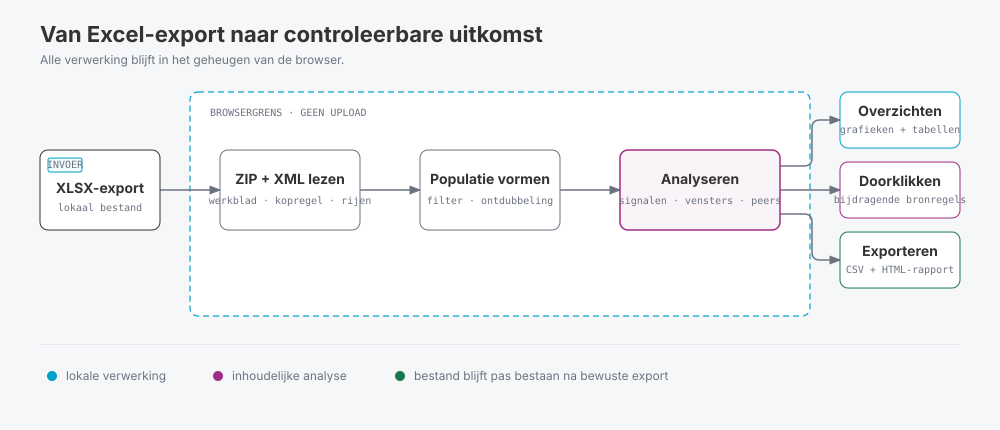

# Ons Escalatielog Audit

Ons Escalatielog Audit is een zelfstandige webpagina voor het controleren van `.xlsx`-exports met escalatielogs uit Nedap Ons. De webui maakt opvallende patronen zichtbaar en laat je doorklikken naar de bijbehorende Excelregels. Grafieken en overzichten ondersteunen de controle van deze patronen en de bijbehorende bronregels.

De applicatiekop gebruikt een paarse tijdheatmap als icoon. Het browsertabblad toont een vereenvoudigde variant met vier vakken, als SVG met een PNG-fallback van 32×32 pixels. Alle iconen zijn ingebouwd in het HTML-bestand.

De analyse draait volledig in de browser. Het Excelbestand wordt niet geüpload en de webui maakt geen verbinding met externe diensten.

## Zo werkt de analyse

De browser leest het werkblad en filtert bekende systeemregels en exacte duplicaten uit de inhoudelijke tellingen. De overgebleven regels vormen de auditpopulatie.

Op basis hiervan berekent de webui tellingen, signalen, tijdvensters en vergelijkingen met vergelijkbare medewerkers. Je kunt vanuit iedere uitkomst de bijbehorende bronregels bekijken.

> [!IMPORTANT]
> Een signaal is geen bewijs van onrechtmatige toegang of dossierinzage. Controleer altijd de achterliggende gegevens voordat je conclusies trekt.

## Wat doet de webui?

De webui biedt de volgende mogelijkheden:

- **Tellingen en overzichten.** Bekijk escalaties per medewerker, cliënt, locatie, team, deskundigheid, reden en tijdstip. Bekende systeemmeldingen en exacte duplicaten tellen niet mee in de inhoudelijke resultaten.
- **Patroonherkenning.** Onderzoek her-escalaties, hoge volumes, spreiding over cliënten, nachtgebruik en problemen met de datakwaliteit.
- **Peervergelijkingen.** Vergelijk medewerkers met vergelijkbare collega's. De gebruikte peer-ratio's worden bij de tabel toegelicht. De analyse onderzoekt ook korte pieken, cliëntclusters en concentraties.
- **Uitleg bij signalen.** Lees hoe de webui controleprioriteit, her-escalaties, geselecteerde tijdvensters, peer-ratio's en top-3-concentratie bepaalt. Deze uitleg staat zowel in de webui als in het HTML-rapport. Details tonen de gekoppelde tijden. Het rapport bevat bij her-escalatie ook een fictief rekenvoorbeeld.
- **Tijdlijnen.** Bekijk wanneer een activatie als laat telt en welke starturen binnen het nachtvenster vallen. Late activatie begint strikt ná de ingestelde grens. De tijdlijnen gebruiken de actuele analyse-instellingen en staan ook in het HTML-rapport.
- **Opvallendheden om te onderzoeken.** Bekijk standaard tien bevindingen en pas het aantal aan van 1 tot en met 50. De drie controlecategorieën Activatie en herhaling, Volume en spreiding en Datakwaliteit kunnen dezelfde auditregels bevatten; hun aantallen zijn daarom niet optelbaar.
- **Controleerbare brongegevens.** Open vanuit cijfers, grafieken en tabellen de Excelregels waarop de uitkomsten zijn gebaseerd.
- **Losse visuals.** Exporteer acht gerichte PNG’s in één ZIP: auditsamenvatting, opvallendheden, signalen per thema, tijdpatroon, cliëntspreiding, medewerkers, teams en opgegeven redenen. Kies onder **Eén afbeelding als PNG** een van deze afbeeldingen of het optionele medewerkerprofiel voor een losse download. Iedere afbeelding bevat herkomst en relevante analysecontext. Je kunt de afbeeldingen bijvoorbeeld toevoegen aan een TOPdesk-melding.
- **Dashboard als PNG.** Exporteer het volledige dashboard als één afbeelding met een vaste indeling. Ook onderdelen buiten het zichtbare scherm worden meegenomen, inclusief volledige labels, periode, analysetijdstip, versie en toegepaste instellingen.
- **Rapportages.** Exporteer aandachtspunten, bronregels en een zelfstandig HTML-rapport. Het rapport bevat de auditflow, themabalken, tijdpatronen per weekdag en uur, en topgrafieken naast de bijbehorende tabellen.
- **Interactieve rapporttabellen.** Zoek en filter direct boven de tabellen in het HTML-rapport. Een teller toont hoeveel opgenomen regels zichtbaar zijn. Brede tabellen kun je horizontaal verschuiven. Bij afdrukken worden alle opgenomen regels getoond, ook wanneer filters actief zijn.

Met het toetsenbord wissel je tussen tabbladen met de pijltjestoetsen, Home en End. Sorteer een tabel via de knop in een kolomkop; de pijl toont de richting. Meldingen staan ook bij de exportknoppen en instellingen. Bij ongeldige instellingen gaat de focus naar het veld en lees je welke waarden zijn toegestaan.

De gebruikte berekeningen, definities en signaleringsregels staan in [Berekeningen, tellingen en patroonherkenning](docs/berekeningen-en-patroonherkenning.md).

## Oefenen met de rondleiding

Download [escalatielog-audit-rondleiding.html](escalatielog-audit-rondleiding.html) en open dit bestand rechtstreeks in je browser. Je hebt geen server, installatie of losse Excel-export nodig. De oefenvariant laadt bij openen en verversen automatisch de vaste synthetische gegevens en start op Overzicht. De permanente balk vermeldt de oefenomgeving, applicatieversie en bronfixture. De gewone webui blijft beschikbaar voor je eigen exports.

De rondleiding legt eerst uit wat een escalatielog, bronregel, auditpopulatie en signaal zijn. Op Overzicht staan de populatie- en aandachtspuntenkaarten vóór **Opvallendheden om te onderzoeken**. Tijdens de uitleg blijft de tabbalk in beeld en is het actieve tabblad gemarkeerd. Daarna oefen je met overzichten, bronregels, zoeken en filteren, context, tijdpatronen, datakwaliteit, instellingen en exports. De uitleg benoemt ook wat de cijfers niet aantonen en welke aanvullende informatie je nodig hebt voor een beoordeling.

Onderstreepte knopnamen in de uitleg zijn aanwijsbaar: klik erop of gebruik Tab en Enter om de echte knop in beeld te brengen en te markeren. De actie wordt daarbij niet uitgevoerd. Ook een uitgeschakelde knop wordt gemarkeerd; de focus blijft dan op de verwijzing in de uitleg. De rondleiding meldt dat de knop uitgeschakeld is. Een gesloten knop geeft een beschikbaarheidsmelding. Aangewezen knoppen van de webui blijven ook op mobiel en na een vensterwijziging vrij van de uitleg. Verwijzingen naar tourknoppen wijzen de bediening binnen het uitlegvenster aan.

De uitlegtekst scrolt afzonderlijk; de tourknoppen blijven in hun eigen gedeelte bereikbaar. Bronregeldialogen staan onder de oefenbalk en naast of boven de uitleg. Bij handmatig geopende bronregels kun je met Sluiten of Toon onderdeel terugkeren. Gebruik Vorige en Volgende, of Stoppen om zelfstandig te oefenen. Escape stopt de uitleg; Hervatten keert binnen dezelfde sessie terug naar de huidige stap. Opnieuw beginnen herstelt de standaardinstellingen, Top-X=10 en de synthetische analyse. Je kunt uitsluitend met de ingebouwde verzonnen gegevens werken: import van bron- en instellingenbestanden is uitgeschakeld. Downloads en klembordacties gebeuren alleen na je eigen klik.

Het bestand wordt beheerd als gegenereerd gebruikersartefact in de repositoryhoofdmap. Ontwikkelaars voeren na wijzigingen aan de webui, fixture of tourlaag `uv run python scripts/generate_tour.py` uit; `--check` controleert of het resultaat actueel is. De tests doorlopen de echte bediening rechtstreeks via `file://` en controleren de DOM-ankers. Het bestaande releaseproces neemt het bestand mee als losse bijlage en in de ZIP met controlesommen. Publicatie blijft handmatig.

## Gebruik

Je hoeft niets te installeren en hebt geen webserver nodig.

### Twee manieren om de webui te gebruiken

**Online showcase**

[Bekijk de webui](https://beecave-homelab.github.io/ons-escalatielog-audit/escalatielog-audit-webui.html) direct in je browser.

Deze versie toont het open-source project en volgt de gecontroleerde wijzigingen op `main`. Door caching kan het ongeveer tien minuten duren voordat een nieuwe versie zichtbaar is.

Je kunt de showcase uitproberen met het [synthetische voorbeeldbestand](https://github.com/beecave-homelab/ons-escalatielog-audit/raw/refs/heads/main/tests/fixtures/synthetic-escalatielog.xlsx). Dit bestand bevat geen echte persoonsgegevens.

**Lokale kopie voor analyse**

[Download de nieuwste GitHub Release](https://github.com/beecave-homelab/ons-escalatielog-audit/releases/latest).

Je kunt kiezen uit de losse HTML of een ZIP met de webui, uitleg en diagrammen. Pak de ZIP volledig uit en behoud de mapstructuur.

Gebruik voor analyses een lokaal vastgestelde versie. Controleer de download met het meegeleverde `SHA256SUMS.txt`.

Op macOS:

`shasum -a 256 -c SHA256SUMS.txt`

Op Linux:

`sha256sum -c SHA256SUMS.txt`

Download zowel de HTML als de ZIP om beide bestanden te kunnen controleren.

Beide varianten verwerken de ingelezen Excelgegevens uitsluitend in het geheugen van je browser.

Bij het openen van de online showcase ontvangt GitHub het paginaverzoek en registreert het bezoekers-IP voor beveiligingsdoeleinden. De inhoud van je Excelbestand wordt niet verzonden.

### Analyse uitvoeren

1. Open `escalatielog-audit-webui.html` in een recente versie van Edge, Chrome, Firefox of Safari. Minimaal vereist zijn Edge/Chrome 80, Firefox 113 of Safari 16.4.
2. Selecteer een `.xlsx`-export of sleep het bestand naar het uploadvak.
3. Open zo nodig **Instellingen** en pas de drempels of signalen aan. Dit kan ook al vóór het kiezen van een bestand. Klik daarna op **Analyse uitvoeren**.
4. Controleer eerst **Auditlogica** en **Datakwaliteit**.
5. Bekijk vervolgens **Overzicht** en **Aandachtspunten**. De gemengde selectie **Opvallendheden om te onderzoeken** toont auditregels, bursts en cliëntclusters met hun selectiereden. Kies hoeveel je wilt zien (1–50) en klik op **Selectie toepassen**. Onder **Samenvatting maken en kopiëren** begint de standaardtekst met lopende zinnen. Je kunt het sjabloon met toegestane placeholders aanpassen, het tekstvoorbeeld controleren en de samenvatting kopiëren. Deze tekst kan persoonsgegevens bevatten.
6. Klik op een cijfer, grafiek of tabelregel om de bijbehorende bronregels te openen. Je kunt deze doorzoeken en filteren op team, deskundigheid, doeltype en auditcontext. **Bronregels CSV** bevat de volledige geopende selectie, ook wanneer filters actief zijn.
7. Pas zo nodig de instellingen aan en klik op **Analyse opnieuw uitvoeren**.
8. Exporteer de gewenste aandachtspunten, bronregels of rapportages. Je kunt ook kiezen voor **Dashboard als PNG** of **Acht PNG’s als ZIP**. Via **Eén afbeelding als PNG** kies je direct een afzonderlijke afbeelding; het medewerkerprofiel is alleen daar beschikbaar.

De PNG-export en het HTML-rapport gebruiken de laatste succesvolle analyse. Heb je instellingen gewijzigd? Klik dan eerst op **Analyse opnieuw uitvoeren** om die wijzigingen toe te passen. Mislukt die heranalyse, dan blijven de vorige analyse en instellingen actief.

### Instellingen bewaren en inladen

In het instellingenpaneel — via de knop **Instellingen** in het uploadvak — kun je je auditinstellingen als een lokaal JSON-bestand bewaren en bij een volgende controle weer inladen.

- **Instellingen exporteren** leest de huidige formulierwaarden, valideert ze en downloadt een bestand `escalatielog-audit-instellingen.json`. Bevat ook waarden die afwijken van de standaardinstellingen. Bij ongeldige invoer verschijnt een foutmelding en wordt geen bestand aangemaakt.
- **Instellingen importeren** leest een `.json`-bestand in de browser. Het bestand wordt gecontroleerd op structuur, formaatnaam, formaatversie, verwachte sleutels, typen en bereiken. Een ongeldig bestand wordt volledig afgewezen; bestaande formulierwaarden en analyseresultaten blijven ongemoeid.
- Na een geslaagde import vul je het instellingenformulier in. De ingelezen waarden zijn pas toegepast na **Analyse uitvoeren** of **Analyse opnieuw uitvoeren**. Tot die tijd blijven exports de toegepaste instellingen van de laatste analyse tonen.

Het bestand bevat uitsluitend configuratie uit `SETTINGS_SCHEMA`: drempels en signaalschakelaars. Geen Excelgegevens, analyseresultaten, bronregels of persoonsgegevens. Het JSON-bestand heeft een onafhankelijke `schemaVersion` (huidig: `1`) die los staat van de app-versie. De functionaliteit gebruikt geen browseropslag of netwerkverkeer.

## Vereiste invoer

Gebruik het [Excel-rapport van het escalatielog](https://support.nedap-ons.nl/support/solutions/articles/103000265692-ons-autorisatie-uitgevoerde-escalaties-in-het-escalatielog-bekijken#excel-rapport) uit Nedap Ons.

De webui verwacht de volgende 14 kolommen:

- `Gebruiker`
- `Medewerkernummer`
- `Medewerkersteam`
- `Deskundigheid medewerker`
- `Gebruikersnaam`
- `Escalatie reden`
- `Tijdsduur (min.)`
- `Escalatiedoel type`
- `Escalatiedoel naam`
- `Escalatiedoel identificatienummer`
- `Hoofdlocatie cliënt`
- `Gestart op`
- `Geactiveerd op`
- `Bron`

De webui zoekt naar het eerste werkblad waarin alle vereiste kolommen voorkomen. De kolomkoppen moeten in een van de eerste tien rijen staan. Gegevens uit meerdere werkbladen worden niet samengevoegd.

Voldoet geen enkel werkblad, dan toont de webui een foutmelding met:

- De ontbrekende kolommen.
- Het werkblad dat het beste overeenkomt.
- Het rijnummer van de mogelijke kopregel.
- Het aantal herkende vereiste kolommen.

De melding vermeldt ook dat alleen de eerste tien rijen zijn gecontroleerd.

Foutcellen in de export, zoals `#N/A`, leest de webui in als lege waarden. Staat een foutcel in een regel die geen systeemmelding is, dan verschijnt die onder **Datakwaliteit** als *Foutcel in bron*, zodat je de export kunt controleren. Foutcellen in systeemmeldingen worden daar niet gemeld.

Een afzonderlijk onderdeel van het XLSX-bestand mag uitgepakt maximaal 512 MB groot zijn; grotere onderdelen weigert de webui met een melding.

## Uitkomsten beoordelen

Controleer bij iedere analyse:

1. Of de export de juiste periode bevat.
2. Welke systeemregels en duplicaten buiten de inhoudelijke tellingen zijn gehouden.
3. Of ontbrekende of ongeldige waarden invloed hebben op de resultaten.
4. Of de ingestelde drempels passen bij je eigen organisatie.
5. Welke bronregels bij een signaal horen.
6. Of de planning, het rooster, de autorisatie of de dossierlogging het gevonden patroon verklaart.

De verschillende onderdelen van de webui gebruiken niet altijd dezelfde selecties. **Datakwaliteit** onderzoekt bijvoorbeeld ook duplicaten, terwijl de inhoudelijke tellingen deze regels niet dubbel meetellen.

Eén bronregel kan meerdere signalen opleveren. Bij **Aandachtspunten** telt die regel echter maar één keer mee.

Lees de [technische documentatie](docs/berekeningen-en-patroonherkenning.md) voor de precieze definities en berekeningen.

## Privacy

De webui verwerkt de Excelgegevens uitsluitend in het geheugen van de browser. Wanneer je de pagina sluit of vernieuwt, worden de ingelezen gegevens gewist.

Bestanden die je exporteert, blijven wel op je apparaat staan. ZIP-, PNG-, CSV- en HTML-bestanden kunnen persoonsgegevens bevatten. Het HTML-rapport voert alleen zijn eigen filterscript uit; de beveiligingsrichtlijn (CSP) staat alleen dat script toe via een SHA-256-hash.

Bewaar en deel deze bestanden volgens de interne afspraken van je organisatie.

## Licentie

Dit project valt onder de [MIT-licentie](LICENSE).
