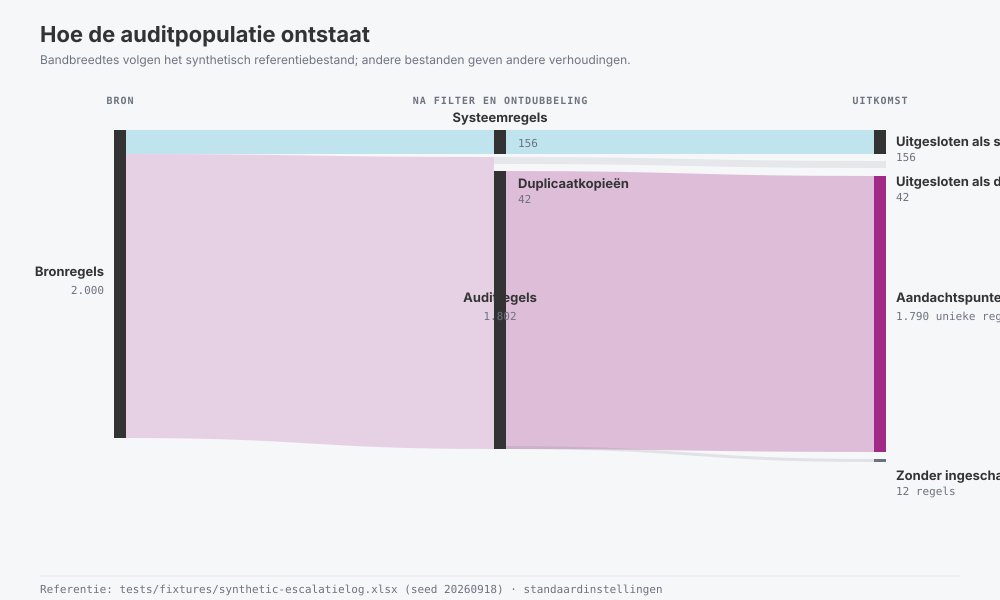
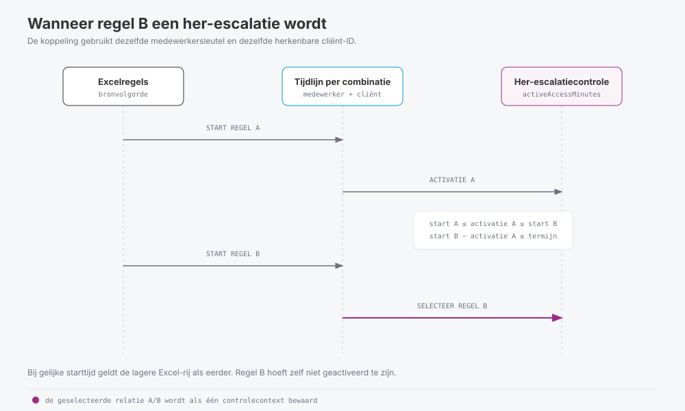
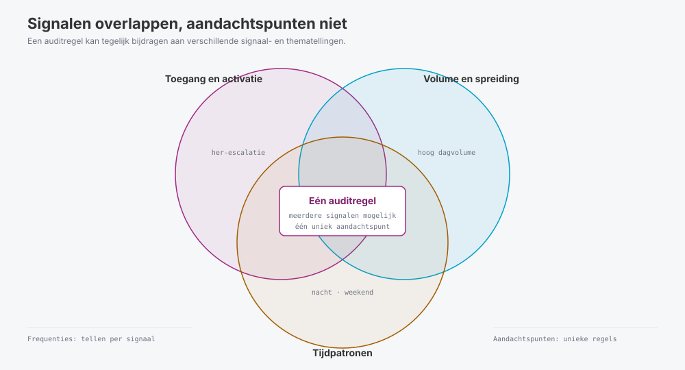
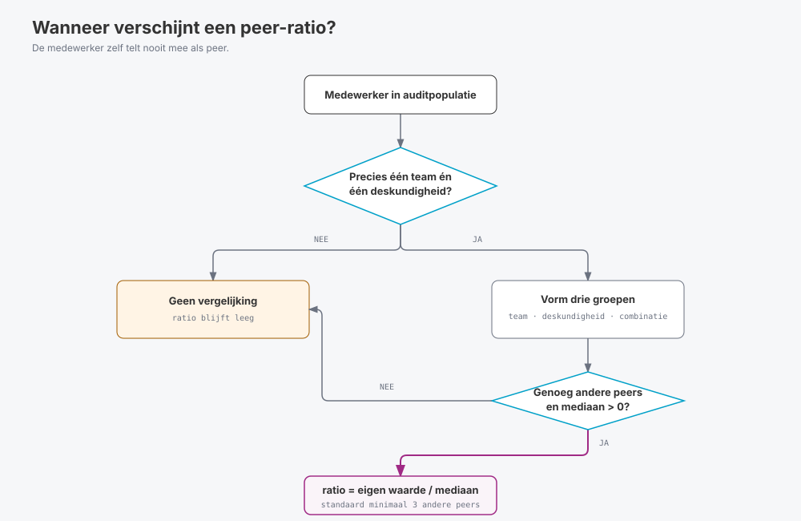
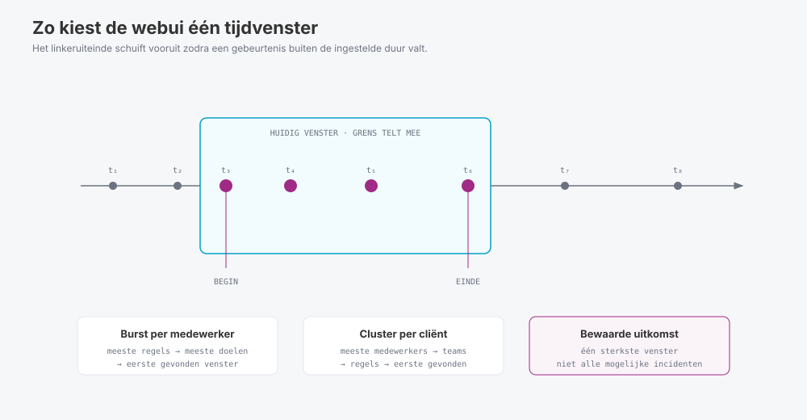

## Berekeningen, tellingen en patroonherkenning

Dit document beschrijft de berekeningen in `escalatielog-audit-webui.html`. Je leest welke regels meetellen, hoe de webui gegevens groepeert en welke tellers en noemers bij de uitkomsten horen. Ook de verwerking van grenswaarden, tijdvensters en gelijke standen wordt uitgelegd.

De HTML-code bepaalt het daadwerkelijke gedrag van de webui. Als de documentatie en implementatie van elkaar afwijken, geldt de implementatie. De documentatie moet dan worden bijgewerkt.

Een escalatieregel registreert een poging of gebeurtenis rond uitzonderlijke toegang. Een geregistreerde activatie bewijst niet dat iemand daarna dossiergegevens heeft bekeken. Een auditsignaal wijst op een gebeurtenis die nader onderzoek vraagt, maar bewijst geen onrechtmatige toegang.

## 1. Reikwijdte

De webui verwerkt per analyse één Excelbestand. Het zoekt in de eerste tien rijen naar alle vereiste kolomkoppen en kiest het eerste passende werkblad. Meerdere werkbladen worden niet samengevoegd.

Alle berekeningen gebruiken de ingelezen export en de instellingen van de laatst uitgevoerde analyse.

Zoeken, sorteren en filteren verandert alleen de tabelweergave. De auditpopulatie, berekeningen, grafieken en exports blijven gelijk.

Dit document beschrijft het gedrag van de huidige implementatie. Het bevestigt geen leveranciersspecificaties, wettelijke verplichtingen of volledige naleving van normen. Controleer daarom de inrichting en beschikbare logging van Nedap Ons voordat je de uitkomsten inhoudelijk beoordeelt.

De ingebouwde XLSX-lezer is bedoeld voor een escalatielog-export uit de Autorisatie-module van Nedap Ons, met één werkblad en tekst- of getalcellen. De lezer ondersteunt geen ZIP64-bestanden.

Foutcellen zoals `#N/A` worden als lege waarde ingelezen. In regels die niet als systeemmelding zijn herkend, meldt **Datakwaliteit** ze als *Foutcel in bron*. Fonetische hulptekst in gedeelde tekenreeksen wordt genegeerd. Elementen met een namespaceprefix en cellen of rijen zonder `r`-attribuut worden wel gelezen.

De browser moet `DecompressionStream` ondersteunen. De minimale browserversies zijn Edge/Chrome 80, Firefox 113 en Safari 16.4.

## 2. Technische uitgangspunten

Bij iedere telling is van belang welke regels meetellen. De webui gebruikt hiervoor verschillende verzamelingen.

- **Inhoudelijke analyses** gebruiken `auditRows`. Dit zijn niet-systeemregels na exacte ontdubbeling.
- **Datakwaliteit** gebruikt `manualRows`. Dit zijn niet-systeemregels vóór ontdubbeling, zodat duplicaten zichtbaar blijven.
- **Auditlogica** gebruikt `allRows`. Dit zijn alle geïmporteerde niet-lege bronregels, inclusief systeemregels en duplicaten die later worden uitgesloten.
- **Ontbrekende sleutels** verwijderen een regel niet automatisch uit `auditRows`. De regel kan wel ontbreken in een telling waarvoor die sleutel nodig is.
- **Signaalfrequenties** tellen het aantal regels per signaal. Eén regel met drie signalen telt bij alle drie de signalen mee.
- **Aandachtspunten** tellen unieke auditregels met minimaal één ingeschakeld signaal. Iedere regel telt hier eenmaal, ongeacht het aantal signalen.

De tabellen voor medewerkers, cliënten, locaties, teams, deskundigheden en redenen tonen gegroepeerde resultaten.

Klik je op een tabelregel, dan opent de webui alle auditregels die aan de betreffende groep bijdragen. De selectie beperkt zich niet tot de waarde in één afzonderlijke kolom.

## 3. Invoervelden en hun gebruik

De webui verwacht 14 kolommen. De kolomkoppen moeten binnen de eerste tien rijen van een werkblad staan. De webui gebruikt het eerste werkblad dat aan alle eisen voldoet en voegt werkbladen niet samen.

| Kolom | Gebruik | Beperking |
| -- | -- | -- |
| `Gebruiker` | Weergavenaam en laatste terugval voor medewerkeridentificatie | Namen kunnen wijzigen of bij meerdere personen voorkomen |
| `Medewerkernummer` | Eerste keuze voor de medewerkersleutel | Niet zelf corrigeren of samenvoegen zonder verificatie |
| `Medewerkersteam` | Teamtelling en context voor peers | Is de geregistreerde teamwaarde; bewijst geen behandelrelatie |
| `Deskundigheid medewerker` | Functiegroepen en peercontext | Geen maat voor inzet, bevoegdheid of caseload |
| `Gebruikersnaam` | Tweede keuze voor medewerkeridentificatie en conflictcontrole | Eén account kan in de export aan meerdere nummers zijn gekoppeld |
| `Escalatie reden` | Systeemfilter, redenverdeling en signalen | Opgegeven tekst verklaart niet zelfstandig de noodzaak |
| `Tijdsduur (min.)` | Duurverdeling, datakwaliteit en optioneel duurfilter | Wordt niet gebruikt als toegangstermijn voor her-escalaties |
| `Escalatiedoel type` | Onderscheid tussen cliënt- en locatiedoelen | Onbekende typen vragen controle |
| `Escalatiedoel naam` | Leesbare weergave en volledigheidscontrole | Wordt niet gebruikt als cliënt- of locatiesleutel |
| `Escalatiedoel identificatienummer` | Sleutel voor cliënt- of locatieanalyse | Ontbrekend ID verhindert analyse van dat specifieke doel |
| `Hoofdlocatie cliënt` | Aanvullende context bij cliënten | Geen bewijs van de locatie tijdens de escalatie of van teamtoegang |
| `Gestart op` | Kalenderdag, uur, volgorde, bursts en her-escalaties | Tijdzone en volledigheid van de export zijn niet vastgelegd in deze velden |
| `Geactiveerd op` | Activatievertraging en eerdere activatie als her-escalatiecontext | `Niet geactiveerd`, ontbrekend en ongeldig zijn verschillende toestanden |
| `Bron` | Technische controle en bronregeldetail | In het referentiebestand alleen `Synthetische generator`; maakt daarom geen onderscheid in de analyse |

### Importdiagnostiek

Als geen werkblad alle vereiste kolommen bevat, toont de webui een foutmelding. Deze vermeldt hoeveel kolommen vereist zijn en hoeveel leesbare werkbladen zijn gevonden.

De controle bekijkt uitsluitend de eerste tien Excelrijen van ieder leesbaar werkblad. Een kopregel op rij 11 of later wordt niet geaccepteerd.

Voor de diagnose kiest de webui de rij met de meeste overeenkomende kolomnamen. De melding bevat:

- De naam van het best passende werkblad.
- Het Excel-rijnummer van de mogelijke kopregel, geteld vanaf 1.
- Het aantal herkende vereiste kolommen, bijvoorbeeld 13 van 14.
- De ontbrekende kolommen, in dezelfde volgorde als de vereiste kolommenlijst.

Bij een gelijke stand kiest de webui eerst op werkbladvolgorde en daarna op rijvolgorde.

Kolomkoppen uit verschillende rijen of werkbladen worden niet gecombineerd. De diagnose toont geen overige celinhoud. De werkbladnaam verschijnt als tekst.

Als geen gecontroleerde rij een vereiste kolomnaam bevat, meldt de webui dat expliciet. Alle ontbrekende kolommen worden genoemd, zonder een best passende rij aan te wijzen.

Een bestand zonder leesbare werkbladen geeft de afzonderlijke foutmelding `Geen leesbaar werkblad gevonden.`

De vereiste kolommen en de selectie van het eerste volledig passende werkblad veranderen door deze diagnose niet.

### Foutcellen en duurwaarden

Een Excel-foutcel zoals `#N/A` wordt als lege waarde ingelezen. De webui registreert per rij welke vereiste kolommen een foutcel bevatten en meldt die onder **Datakwaliteit** als *Foutcel in bron*, met de kolomnaam als sleutel. Datakwaliteit onderzoekt `manualRows` (paragraaf 4.3). Een foutcel in een regel die het systeemfilter heeft herkend, verschijnt daarom niet als *Foutcel in bron*. Een rij die alleen uit foutcellen bestaat wordt net als een volledig lege rij overgeslagen.

Een lege of niet-numerieke `Tijdsduur (min.)` vormt in **Auditlogica** onder *Duurverdeling* samen één categorie `(leeg of ongeldig)`, die achteraan de verdeling staat. Dezelfde regels tellen onder **Datakwaliteit** mee als *Ongeldige duur*.

### 3.1 Sleutels en normalisatie

Voor de medewerkersleutel gebruikt de webui de eerste beschikbare waarde uit:

1. `Medewerkernummer`
2. `Gebruikersnaam`
3. `Gebruiker`

Een lege waarde of de losse plaatshouder `-` geldt als ontbrekend. Een koppelteken, punt of cijfer binnen een waarde hoort bij die waarde. Gebruikersnamen als `77600-1` en `t.detester` zijn dus gewone identifiers. De webui vergelijkt sleutels letterlijk: `77600-1`, `77600-2` en medewerkernummer `77600` zijn verschillende sleutels.

Als alle drie ontbreken, blijft de regel in de auditpopulatie staan. De regel verschijnt dan niet in het medewerkersoverzicht.

Identificatie op naam is minder betrouwbaar dan identificatie op nummer. De webui meldt conflicten tussen identifiers, maar corrigeert of combineert deze niet automatisch.

Voor cliënten en locaties gebruikt de webui het doel-ID:

- Cliënten worden gegroepeerd op doel-ID bij doeltype `Cliënt`.
- Locaties worden gegroepeerd op doel-ID bij doeltype `Locatie`.
- Bij gemengde doelen bestaat de sleutel uit doeltype en doel-ID.

Een cliënt en locatie met hetzelfde nummer blijven hierdoor twee verschillende doelen.

De webui verwijdert witruimte aan het begin en einde van tekstwaarden.

Bij escalatieredenen past de webui aanvullende normalisatie toe. De tekst wordt omgezet naar kleine letters en opeenvolgende spaties worden vervangen door één spatie. Dit geldt voor groepering en herkenning van systeemredenen.

Synoniemen en inhoudelijk vergelijkbare redenen blijven afzonderlijke groepen. Teams en deskundigheden krijgen deze aanvullende normalisatie niet. Schrijfvarianten kunnen daardoor als aparte groepen verschijnen.

In samenvattingen toont de webui vaak de meest voorkomende naam, teamwaarde of deskundigheid. Dit is uitsluitend een keuze voor de weergave en zegt niets over de actuele organisatorische indeling.

Bij bursts en concentratie gebruikt de webui het team en de deskundigheid uit de eerste bijbehorende regel. Controleer de bronregels wanneer de context binnen een groep wisselt.

### 3.2 Ontbrekende cliëntgegevens

Een cliëntgerichte regel zonder doel-ID blijft meetellen in de auditpopulatie.

Waar mogelijk telt deze regel ook mee in analyses per medewerker, team, reden en tijdstip.

Zonder herkenbaar cliënt-ID telt de regel niet mee bij:

- Unieke cliënten.
- Cliëntspecifieke signalen.
- Cliëntclusters.
- Her-escalaties voor dezelfde cliënt.

Ontbreekt alleen de cliëntnaam en is het ID wel aanwezig, dan kan de webui de regel groeperen. Er ontstaat wel een volledigheidssignaal.

Het referentiebestand bevat 1.611 cliëntgerichte auditregels. Daarvan hebben 1.554 een herkenbaar cliënt-ID en 57 geen herkenbaar cliënt-ID.

Van de 310 niet-geactiveerde regels zijn er 7 cliëntgericht zonder herkenbaar doel-ID.

Deze aantallen beschrijven uitsluitend het referentiebestand. Ze vormen geen algemene regel voor andere exports.

## 4. Van bronbestand naar auditpopulatie

| Verzameling | Definitie |
| -- | -- |
| `allRows` | Niet-lege gegevensrijen onder de gevonden kopregel |
| `systemRows` | Regels die voldoen aan het toegepaste systeemfilter |
| `manualRows` | Alle overige regels, nog vóór ontdubbeling |
| `duplicateRows` | Extra exemplaren van gelijke regels binnen `manualRows` |
| `auditRows` | `manualRows` na ontdubbeling; basis voor inhoudelijke analyses |
| `attention` | Auditregels met minimaal één ingeschakeld signaal |

De naam `manualRows` betekent dat het systeemfilter de betreffende regel niet heeft herkend. Een nieuwe of onbekende systeemreden kan daardoor in deze verzameling terechtkomen.



Het diagram gebruikt het synthetische referentiebestand. De getoonde aantallen en verhoudingen gelden alleen voor dat bestand. De verzamelingen en rekenregels gelden voor iedere analyse.

De aantallen moeten voldoen aan:

```text
bronregels = systeemregels + duplicaatkopieën + auditregels
auditregels = regels met minimaal één signaal + regels zonder ingeschakeld signaal
```

De webui slaat volledig lege rijen over. Andere instructie- of totaalrijen worden niet automatisch verwijderd.

Gebruik daarom een export waarin onder de kolomkoppen uitsluitend werkelijke logregels staan.

### 4.1 Systeemfilter

De webui sluit regels uit waarvan de genormaliseerde escalatiereden precies overeenkomt met een van deze teksten:

```text
Cliënt gekoppeld aan item in Ons Ketenverkeer
Systeemescalatie: sta 30 minuten toegang toe tot cliënt na aanmaken.
Toegang tot cliënt nadat deze is aangemaakt door Ons Ketenverkeer
```

De tijdsduur speelt bij deze herkenning geen rol.

Met `excludeDuration30` kun je daarnaast alle regels uitsluiten waarvan de numerieke duur precies 30 minuten is. Deze instelling staat standaard **uit**.

Een onbekende reden met een duur van 30 minuten blijft daardoor normaal meetellen in de auditpopulatie. De webui toont deze regels als controlepunt onder **Auditlogica**.

Controleer de verdeling van redenen en tijdsduren opnieuw wanneer de export of de applicatie verandert.

In het referentiebestand herkent de webui 156 systeemregels:

- 44 regels met de eerste reden.
- 51 regels met de tweede reden.
- 61 regels met de derde reden.

Al deze regels hebben een duur van 30 minuten.

Een systeemcategorie zonder geldige duur toont in de tabel een lege `Tijdsduur (min.)`. De drilldown van iedere systeemcategorie opent precies de meegetelde bronregels; de analyse legt die regels vast als `__rows` op de categorie.

Daarnaast bevat de auditpopulatie 337 handmatige regels met een duur van precies 30 minuten.

Het aanvullende duurfilter sluit in dit bestand dus extra regels uit. Door de instelling aan en uit te zetten, kun je het verschil controleren.

### 4.2 Duplicaten

De webui vergelijkt de 14 ingelezen bronvelden van alle niet-uitgesloten regels. Vooraf wordt witruimte aan het begin en einde van de waarden verwijderd.

Zijn alle waarden gelijk, dan behoudt de webui het eerste exemplaar. Latere exemplaren worden uitgesloten van de auditpopulatie en verwijzen naar de oorspronkelijke Excel-rij.

De vergelijking gebruikt de ingelezen veldwaarden, niet de oorspronkelijke bestandsbytes.

Omdat de export geen uniek gebeurtenis-ID bevat, kan de webui twee verder identieke gebeurtenissen niet van elkaar onderscheiden.

Exacte ontdubbeling is daarom een bewuste analysekeuze. Beoordeel deze opnieuw als de definitie van de export verandert.

Systeemregels worden vóór deze stap apart gezet en niet ontdubbeld. Het aantal systeemregels is daardoor gelijk aan het aantal uitgesloten bronregels.

Een duplicaatgroep kan bij **Datakwaliteit** drie exemplaren bevatten, terwijl de auditflow bij **Duplicaten** twee uitgesloten kopieën toont.

### 4.3 Datakwaliteit heeft een andere basis

De onderdelen gebruiken verschillende verzamelingen:

- Inhoudelijke tellingen gebruiken `auditRows`.
- **Datakwaliteit** onderzoekt niet-uitgesloten regels vóór ontdubbeling. Daardoor blijven duplicaten zichtbaar.
- **Auditlogica** onderzoekt alle bronregels op tijdsduur, reden, doeltype en bronwaarde.

De aantallen uit deze onderdelen hebben dus niet altijd dezelfde basis. Je kunt ze niet zonder meer vergelijken of bij elkaar optellen.

### 4.4 Bewijs bij Datakwaliteit

Per Datakwaliteit-bevinding legt de analyse de bijbehorende bronregels vast als niet-enumerable `__rows` op het moment dat de bevinding ontstaat. De weergave leest deze metadata alleen uit en leidt geen bewijs meer af.

- **Exact dubbel**: alle regels met dezelfde `exactRowKey` (alle 14 ingelezen bronvelden), inclusief het eerste exemplaar en alle kopieën. Een regel die afwijkt in één veld, zoals `Tijdsduur (min.)` of `Escalatiedoel identificatienummer`, valt buiten deze groep.
- **Ontbrekend/ongeldig veld**: de regels waarvoor het betreffende veld ontbreekt of ongeldig is.
- **Identifierconflict**: de regels die bij de betreffende sleutel horen. Een conflict op medewerkernummer brengt alleen regels met dat nummer mee; een conflict op gebruikersnaam alleen regels met die naam. De sleutelruimtes blijven gescheiden.
- **Redenvariant**: de regels met dezelfde genormaliseerde reden.
- **Tijd/duur**: de regels die aan het bijbehorende predicaat voldoen.
- **Foutcel in bron**: de regels waarin de betreffende kolom een Excel-foutwaarde bevatte die als lege waarde is ingelezen.

Het aantal bronregels in de drilldown is hierdoor consistent met `Aantal` en de toelichting van de bevinding. Bij *Exact dubbel*, *Ontbrekend/ongeldig veld*, *Tijd/duur* en *Foutcel in bron* telt `Aantal` bronregels. Bij *Identifierconflict* telt het verschillende niet-lege namen, gebruikersnamen of medewerkernummers, afhankelijk van het conflict. Bij *Redenvariant* telt het verschillende niet-lege schrijfwijzen. Voor die laatste twee typen kan de drilldown dus meer bronregels bevatten dan `Aantal`, omdat meerdere regels dezelfde waarde kunnen hebben.

## 5. Kerncijfers, tellers en noemers

| Maat | Berekening | Interpretatie |
| -- | -- | -- |
| Auditpopulatie | Aantal `auditRows` | Resterende unieke logregels, inclusief niet-geactiveerde pogingen |
| Auditpopulatie als percentage | `100 × auditregels / bronregels` | Houdt rekening met systeemregels én duplicaatkopieën |
| Aandachtspunten | Unieke auditregels met minimaal één ingeschakeld signaal | Eén regel telt eenmaal, ook bij meerdere signalen |
| Aandachtspunten als percentage | `100 × aandachtspunten / auditregels` | Omvang van de controleselectie, geen percentage overtredingen |
| Medewerkers | Verschillende beschikbare medewerkersleutels in de auditpopulatie | Geen personeelsbestand en geen volledige teambezetting |
| Cliënten | Verschillende herkenbare doel-ID's bij cliëntgerichte auditregels | Pogingen zonder cliënt-ID tellen niet mee |
| Niet geactiveerd | Regels met de tekst `Niet geactiveerd` in het activatieveld | Ontbrekende of ongeldige activatietekst telt hier niet automatisch mee |
| Niet geactiveerd als percentage | `100 × expliciet niet-geactiveerde auditregels / auditregels` | Het totaal omvat cliënt- en locatieregels |
| Signaalfrequentie | Aantal auditregels waarop één specifiek signaal staat | Frequenties van verschillende signalen kunnen overlappen |
| Regels per controlethema | Unieke auditregels met minimaal één signaal binnen dat thema | Binnen een thema eenmaal tellen; tussen thema's is overlap mogelijk |

De webui berekent her-escalaties en zeer snelle her-escalaties op basis van de gevonden intervallen.

De bijbehorende schakelaars bepalen alleen of deze gebeurtenissen ook als aandachtspunt meetellen. Een beschrijvend aantal kan dus zichtbaar blijven wanneer je het betreffende signaal uitschakelt.

De meeste percentages worden met één decimaal weergegeven. Peer-ratio's krijgen twee decimalen.

Algemene percentagefuncties tonen bij een lege populatie `0%`. Dit betekent dat de berekeningsbasis leeg is, niet dat het verschijnsel aantoonbaar niet is voorgekomen.

Een peer-ratio blijft leeg wanneer er te weinig vergelijkingsmateriaal is of wanneer de groepsmediaan nul is.

## 6. Basisanalyses en vergelijkbaarheid

### 6.1 Medewerkers

De webui berekent per medewerkersleutel:

- Het aantal auditregels.
- Het aantal unieke herkenbare cliënten en locaties.
- De gebruikte escalatieredenen.
- Het aantal actieve dagen en het hoogste dagvolume.
- Niet-geactiveerde pogingen.
- Nacht- en weekendregels.
- Berekende her-escalaties.
- Regels met signalen.
- Het eerste en laatste geldige starttijdstip.

Een actieve dag is een kalenderdag waarop minimaal één auditregel met een geldige startdatum voorkomt. Dit is niet hetzelfde als een gewerkte dag of dienst.

Een medewerker kan in het overzicht over meerdere teams of deskundigheden zijn samengevat. Voor peervergelijkingen gelden daarom aanvullende voorwaarden.

### 6.2 Cliënten en locaties

De tabellen groeperen auditregels op doeltype en doel-ID.

Per groep toont de webui het volume en de spreiding over medewerkers, teams, deskundigheden en redenen.

Niet-geactiveerde pogingen met een herkenbaar doel tellen mee.

Het aantal verschillende medewerkers bij een cliënt is het aantal geregistreerde medewerkers met een escalatiepoging. Het zegt niet hoeveel medewerkers daadwerkelijk het dossier hebben ingezien.

De kolom `Hoofdlocatie` bij een cliënt biedt aanvullende context. Het tabblad **Locaties** gaat uitsluitend over escalaties met doeltype `Locatie`.

### 6.3 Teams en deskundigheden

De webui gebruikt voor iedere regel het geregistreerde team en de deskundigheid.

Komt een medewerker bij meerdere teams voor, dan kan die persoon in verschillende teamgroepen meetellen.

Tel unieke aantallen uit afzonderlijke groepen daarom niet op tot één organisatietotaal.

```text
escalaties per waargenomen medewerker =
  aantal auditregels van de groep / aantal herkenbare medewerkers in die groep
```

De noemer bevat uitsluitend medewerkers die in de auditpopulatie voorkomen.

Medewerkers zonder escalaties ontbreken. De export bevat bovendien geen volledige gegevens over FTE, gewerkte uren, diensten of caseload.

De maat corrigeert daardoor niet voor teamomvang of werklast.

Wanneer medewerkersleutels ontbreken, kan de teller auditregels bevatten waarvan de medewerkers niet in de noemer staan.

De implementatie gebruikt technisch minimaal 1 als deler. Als er geen herkenbare medewerkers zijn, is de getoonde uitkomst geen bruikbaar gemiddelde.

Het nachtpercentage per deskundigheid wordt berekend als:

```text
nachtpercentage =
  aantal nachtregels / alle auditregels van de deskundigheid
```

Regels met een ongeldige startdatum blijven in de noemer staan. De webui kan ze echter niet als nachtregel herkennen.

Controleer daarom eerst de datakwaliteit voordat je percentages tussen groepen vergelijkt.

### 6.4 Redenen

De webui groepeert escalatieredenen na normalisatie.

De tabel toont:

- Aantallen en schrijfvarianten.
- Betrokken medewerkers, cliënten en teams.
- Niet-geactiveerde pogingen.
- Regels met signalen.

De meest voorkomende tijdsduur is een beschrijvende waarde. De webui gebruikt deze niet om de geldigheidsduur van toegang vast te stellen.

Ontbrekende redenen kunnen als lege categorie verschijnen.

Niet alle samenvattingen behandelen ontbrekende waarden hetzelfde bij het tellen van unieke redenen. Gebruik daarom het tabblad **Redenen** en de bronregels wanneer ontbrekende waarden van belang zijn voor je vergelijking.

### 6.5 Tijdpatronen

De webui groepeert auditregels met een geldig starttijdstip per datum, uur en weekdag.

De heatmap combineert weekdag en uur. Deze telling wordt vastgelegd in het analyseresultaat, zodat de heatmap in de webui en de weekdag/uur-matrix in het HTML-rapport dezelfde waarden tonen.

Auditregels met een ongeldige startdatum blijven in de auditpopulatie, maar tellen niet mee bij tijdgebonden berekeningen.

Het HTML-rapport vermeldt het aantal regels zonder geldige startdatum afzonderlijk.

De volgende controle moet daarom kloppen:

```text
som van alle matrixcellen + regels zonder geldige startdatum = auditpopulatie
```

De grafieken tonen ruwe aantallen. Ze corrigeren niet voor:

- Het aantal maandagen of zondagen in de export.
- De bezetting van diensten.
- Ontbrekende exportdagen.

Het datumoverzicht bevat alleen dagen waarop auditregels met een geldige startdatum voorkomen.

Een ontbrekende datum bewijst niet dat er die dag geen activiteit was.

Het getoonde datumbereik loopt van het eerste tot het laatste geldige starttijdstip dat de webui vindt.

De gebruikte populatie verschilt per onderdeel:

- Het overzicht gebruikt de auditpopulatie.
- Exportbestandsnamen en het HTML-rapport gebruiken de bronpopulatie.

Deze bereiken kunnen verschillen wanneer op de eerste of laatste dagen alleen systeemregels voorkomen.

Geen van beide bereiken bewijst dat de volledige bedoelde exportperiode aanwezig is.

## 7. Tijdstippen en toegangstermijn

De datumparser ondersteunt numerieke Excel-datums in het 1900-datumsysteem, datumtijdtekst zoals `01-05-2026, 09:30:00` en de ondersteunde ISO-vorm zonder tijdzone.

Onmogelijke kalenderdatums en kloktijden worden afgewezen.

Een datum zonder tijd, zoals `01-05-2026`, wordt niet herkend en telt daarom als ongeldige startdatum.

Bij een bestand met het 1904-datumsysteem toont de webui een foutmelding.

De webui gebruikt de kloktijden uit de export, onafhankelijk van de tijdzone van de browser. De tijdzone van de bron wordt niet vastgesteld en tijdstippen worden niet omgerekend.

Tijdsverschillen rond de overgang tussen zomer- en wintertijd zijn daardoor onzeker.

Ook gebeurtenissen die plaatsvonden vóór het begin van de export zijn niet bekend.

In het referentiebestand komen de volgende tijdsduren voor:

| Duur (minuten) | Auditregels |
| -- | -: |
| 15 | 388 |
| 30 | 337 |
| 60 | 345 |
| 120 | 349 |
| 840 | 383 |

Voor her-escalaties gebruikt de webui daarnaast `activeAccessMinutes = 840`.

Deze periode van 14 uur is een overgenomen functionele aanname voor triage. De export bevestigt niet dat toegang gedurende deze volledige periode geldig bleef of dat deze niet tussentijds is ingetrokken.

Laat FAB controleren of de ingestelde toegangstermijn overeenkomt met de inrichting van Nedap Ons.

Een onjuiste termijn verandert welke her-escalaties worden geselecteerd. Bewaar daarom bij iedere beoordeling de toegepaste instellingen.

## 8. Her-escalaties en activatievertraging

### 8.1 Her-escalatie tijdens aangenomen actieve toegang

Voor een nieuwe regel B zoekt de webui een eerdere regel A in dezelfde auditpopulatie.

Beide regels moeten dezelfde medewerkersleutel en hetzelfde herkenbare cliënt-ID hebben. Ook moeten beide starttijdstippen geldig zijn.

Regel A moet een leesbare activatie bevatten die niet vóór de eigen start ligt.



De webui gebruikt deze tijdsvoorwaarden:

```text
start A <= start B
start A <= activatie A <= start B
0 <= start B - activatie A <= activeAccessMinutes
```

Alle grenswaarden tellen mee.

Als twee regels dezelfde starttijd hebben, beschouwt de webui de regel met het laagste Excel-rijnummer als de eerdere regel.

Hierdoor is de uitkomst bij dezelfde invoer reproduceerbaar. Het bewijst niet welke gebeurtenis binnen die seconde werkelijk als eerste plaatsvond.

Regel B hoeft zelf niet geactiveerd te zijn.

Van alle passende eerdere regels gebruikt de webui de meest recente activatie die op het startmoment van B al beschikbaar was.

Een eerdere poging die pas ná de start van B activeert, verdringt een al beschikbare activatie niet.

Bij het aandachtspunt bewaart de webui het rijnummer van de geselecteerde eerdere regel. Dit nummer wordt bij doorklikken getoond.

Zonder cliënt-ID, medewerkersleutel of startdatum kan de webui geen koppeling maken.

Een activatie vóór de eigen start is voor deze controle geen geldige eerdere activatie.

### 8.2 Zeer snelle her-escalatie

Een zeer snelle her-escalatie is een aanvullend kenmerk van dezelfde geselecteerde relatie tussen A en B.

```text
her-escalatie volgens paragraaf 8.1
en 0 <= start B - start A <= veryFastRepeatMinutes
```

De standaardgrens is 5 minuten.

De webui vergelijkt hiervoor de starttijd van B met de starttijd van de eerdere regel A die bij de actieve-toegangscontrole is geselecteerd.

Het gaat dus niet om iedere willekeurige eerdere escalatiepoging.

Een reeks niet-geactiveerde pogingen zonder geldige eerdere activatie krijgt op deze grond geen zeer-snel-signaal.

### 8.3 Activatievertraging

De webui berekent activatievertraging als:

```text
activatievertraging in minuten = (activatie - start) / 60 seconden
late activatie als activatievertraging > activationDelayThresholdMinutes
```

De standaardgrens is strikt meer dan 2 minuten.

De berekening gebruikt het ongeronde tijdsverschil. De tabel toont een afgeronde waarde.

Een activatie na precies 2 minuten krijgt dus geen signaal voor late activatie. Een activatie na 2 minuten en 1 seconde wel.

Een negatieve vertraging krijgt een datakwaliteitssignaal.

Dat geldt ook wanneer de activatie ontbreekt of niet leesbaar is, behalve als het veld letterlijk `Niet geactiveerd` bevat.

`Niet geactiveerd` is een afzonderlijke geregistreerde toestand. De tekst vertelt niet waarom de activatie uitbleef.

## 9. Auditsignalen

De webui kent signalen toe aan auditregels op basis van de toegepaste instellingen.

Drempelwaarden helpen bij het selecteren van patronen. Het zijn geen normen voor toegestaan of ongeoorloofd gedrag.

| Signaal | Standaardcriterium | Welke regels krijgen het signaal? |
| -- | -- | -- |
| `NIET_GEACTIVEERD` | Aan | Regels met expliciet `Niet geactiveerd` |
| `NACHT` | Aan; 23:00 tot 06:00 | Startuur ≥ 23 of < 6; begin inclusief, einde exclusief |
| `WEEKEND` | Uit | Bij inschakelen: zaterdag of zondag |
| `HOOG_DAGVOLUME` | ≥ 15 | Alle regels van de medewerker op die kalenderdag |
| `VEEL_UNIEKE_CLIENTEN_MEDEWERKER` | ≥ 50 herkenbare cliënten | Alle auditregels van de medewerker in de export, ook diens locatieregels |
| `VEEL_MEDEWERKERS_CLIENT` | ≥ 4 herkenbare medewerkers | Alle auditregels voor die herkenbare cliënt |
| `VEEL_TEAMS_CLIENT` | ≥ 3 niet-lege teams | Alle auditregels voor die herkenbare cliënt |
| `HERESCALATIE_TIJDENS_ACTIEVE_TOEGANG` | Aan; ≤ 840 minuten | De nieuwe regel die aan paragraaf 8.1 voldoet |
| `ZEER_SNELLE_HERESCALATIE` | Aan; ≤ 5 minuten | De nieuwe regel die aan paragraaf 8.2 voldoet |
| `LATE_ACTIVATIE` | Aan; > 2 minuten | De vertraagd geactiveerde regel |
| `ZELDZAME_REDEN` | Uit; ≤ 2 keer | Bij inschakelen: regels met een reden die maximaal zo vaak in de auditpopulatie voorkomt |
| `ONGELDIGE_STARTDATUM` | Datakwaliteit aan | Start ontbreekt of de webui kan deze niet lezen |
| `ONTBREKENDE_KERNVELDEN` | Datakwaliteit aan | Gebruiker, medewerkernummer, team of reden ontbreekt |
| `ONVOLLEDIG_CLIENTDOEL` | Datakwaliteit aan | Cliëntdoel mist cliënt-ID of cliëntnaam |
| `ONGELDIGE_ACTIVATIE` | Datakwaliteit aan | Activatie ontbreekt, is onleesbaar of ligt vóór de start; expliciet niet-geactiveerde regels uitgezonderd |
| `ONGELDIGE_DUUR` | Datakwaliteit aan | Duur ontbreekt, is niet numeriek of is negatief |

Eén groepssignaal kan aan veel regels worden toegekend.

Honderd regels met `HOOG_DAGVOLUME` betekenen bijvoorbeeld niet dat er honderd afzonderlijke piekdagen waren.

De drempels voor medewerkers en cliënten worden toegepast op het volledige bestand. De lengte van de exportperiode beïnvloedt daardoor welke signalen ontstaan.

Als het begin- en einduur van het nachtvenster gelijk zijn, is het venster leeg.

De webui blijft nacht- en weekendtellingen berekenen wanneer je de bijbehorende signalen uitschakelt.

## 10. Controleprioriteit en overlap

De webui deelt signalen in vier controlethema's in.

| Thema | Signalen |
| -- | -- |
| Toegang en activatie | Her-escalatie, zeer snelle her-escalatie, niet geactiveerd, late activatie |
| Volume en spreiding | Hoog dagvolume, veel cliënten per medewerker, veel medewerkers of teams per cliënt, zeldzame reden |
| Tijdpatronen | Nacht en weekend |
| Datakwaliteit | Ontbrekende kernvelden of cliëntgegevens, ongeldige start, activatie of duur |



Het diagram toont drie van de vier thema's om de overlap leesbaar te houden.

Ook datakwaliteit kan op dezelfde auditregel voorkomen als een of meer andere thema's.

Een regel mag meetellen bij meerdere signalen en thema's. In **Aandachtspunten** telt iedere auditregel echter maar één keer.

De webui kent alleen aan aandachtspunten een controleprioriteit toe.

| Prioriteit | Regel |
| -- | -- |
| Hoog | Het ingeschakelde her-escalatiesignaal is aanwezig, of er zijn signalen uit minimaal drie thema's |
| Midden | Twee thema's, zonder de bovenstaande hoge prioriteit |
| Basis | Overige aandachtspunten |

Bij een niet-geactiveerde poging telt `ONVOLLEDIG_CLIENTDOEL` niet opnieuw mee bij het bepalen van het aantal prioriteitsthema's.

Het signaal blijft wel zichtbaar en telt mee in de datakwaliteitsthemakaart.

Hierdoor kun je de aantallen van themakaarten en prioriteitsgroepen niet rechtstreeks bij elkaar optellen.

De prioriteit bepaalt uitsluitend de volgorde van controle.

De webui toont hiermee niet aan dat de thema's onafhankelijk van elkaar zijn. De prioriteitslabels geven ook geen oordeel over de ernst of waarschijnlijkheid van een overtreding.

De aandachtspuntentabel sorteert op:

1. Controleprioriteit.
2. Aantal signalen.
3. Starttijd.

In het referentiebestand overlappen verschillende signalen.

`ONVOLLEDIG_CLIENTDOEL` komt voor op 57 regels zonder herkenbaar doel-ID. Daarvan hebben 7 ook `NIET_GEACTIVEERD`.

Samen blijven dit 57 unieke regels, geen 114 afzonderlijke bevindingen.

Ook een zeer snelle her-escalatie en een her-escalatie kunnen hetzelfde patroon beschrijven.

## 11. Verdiepende analyses

### 11.1 Peervergelijking

De webui kan een medewerker alleen met peers vergelijken wanneer alle bijbehorende auditregels precies één ingevuld team en één ingevulde deskundigheid bevatten.

Als het team of de deskundigheid wisselt of een waarde ontbreekt, berekent de webui geen peer-ratio voor deze medewerker.

De medewerker wordt dan ook niet als peer van andere medewerkers gebruikt.

Voor iedere vergelijkbare medewerker maakt de webui drie groepen met andere medewerkers:

1. Medewerkers uit hetzelfde team.
2. Medewerkers met dezelfde deskundigheid.
3. Medewerkers met hetzelfde team én dezelfde deskundigheid.

De medewerker zelf telt niet mee.

Standaard moeten per groep minimaal drie **andere** medewerkers beschikbaar zijn.

De webui sorteert de waarden en bepaalt vervolgens de mediaan. Bij een oneven aantal peers is dit de middelste waarde. Bij een even aantal gebruikt de webui het gemiddelde van de twee middelste waarden.



| Getoonde ratio | Teller | Noemer |
| -- | -- | -- |
| Volume / team | Auditregels medewerker | Mediaan auditregels van andere vergelijkbare teamleden |
| Cliënten / team | Unieke herkenbare cliënten medewerker | Mediaan unieke cliënten van andere vergelijkbare teamleden |
| Volume / deskundigheid | Auditregels medewerker | Mediaan auditregels van andere vergelijkbare medewerkers met die deskundigheid |
| Volume / team+deskundigheid | Auditregels medewerker | Mediaan auditregels van andere vergelijkbare medewerkers met die combinatie |

De ratio blijft leeg bij te weinig peers of een mediaan van nul.

Een ratio van 2 betekent dat de gemeten waarde binnen deze export tweemaal zo hoog is als de groepsmediaan.

Dit betekent niet dat de werklast of het risico tweemaal zo hoog is.

**Rekenvoorbeeld**

Medewerker A heeft 20 auditregels. Drie passende medewerkers hebben respectievelijk 4, 10 en 16 regels.

De mediaan is 10. De ratio van medewerker A is dan `20 / 10 = 2,00`.

Zijn er slechts twee passende medewerkers, dan blijft de ratio met de standaardinstellingen leeg.

De vergelijking bevat uitsluitend medewerkers die in de auditpopulatie voorkomen. Medewerkers zonder auditregels ontbreken.

De webui corrigeert niet voor:

- Diensten.
- FTE.
- Inzetduur.
- Caseload.
- Verschillen in autorisatie.

Voor het nachtpercentage en het aantal cliënten per deskundigheid berekent de webui geen peer-ratio.

Bij doorklikken toont de webui de bronregels van de medewerker en de gebruikte peers uit de team- en deskundigheidsgroepen.

De combinatiegroep bestaat uit medewerkers die in beide groepen voorkomen.

Daardoor bevat het bronregelvenster meer regels dan alleen de teller van één ratio.

De webui en het HTML-rapport tonen bij de peeranalysetabel:

- De gebruikte formule en vier teller-noemercombinaties.
- Een rekenvoorbeeld.
- De betekenis van de referentiewaarden `0,50`, `1,00` en `2,00`.
- De beperkingen van de vergelijking.

In het HTML-rapport staat deze uitleg binnen dezelfde inklapbare sectie als de tabel.

Het doorklikvenster **Bronregels achter peeranalyse** is bedoeld om de onderliggende regels te controleren. De uitleg van de ratio's staat bij de tabel.

### 11.2 Bursts per medewerker

Een burst is een groot aantal escalatiepogingen van één medewerker binnen een voortschrijdend tijdvenster.

De analyse gebruikt alleen auditregels met een medewerkersleutel en een geldige starttijd.

Alle doeltypen kunnen meetellen. Een ontbrekend doel-ID telt wel als poging, maar niet als herkenbaar uniek doel.

Het standaardvenster is 60 minuten. De standaarddrempel is 5 regels.

Gebeurtenissen precies op de tijdsgrens tellen mee.

De webui selecteert per medewerker maximaal één venster volgens deze volgorde:

1. Het venster met de meeste regels.
2. Bij een gelijke stand het venster met de meeste verschillende herkenbare doelen.
3. Als ook dat gelijk is, het eerst gevonden venster.

De begin- en eindtijd zijn de tijdstippen van de eerste en laatste gebeurtenis in het geselecteerde venster.

Het verschil tussen deze tijdstippen kan korter zijn dan 60 minuten.

De tabel telt medewerkers met een geselecteerd burstvenster. Dit is niet hetzelfde als het aantal afzonderlijke incidenten of alle mogelijke bursts.

### 11.3 Cliëntclusters

Deze analyse gebruikt uitsluitend cliëntgerichte auditregels met een herkenbaar cliënt-ID en een geldige starttijd.

De webui onderzoekt per cliënt voortschrijdende tijdvensters van standaard 120 minuten.

Een venster voldoet aan de standaarddrempel wanneer het minimaal 3 herkenbare medewerkers **of** minimaal 2 ingevulde teams bevat.

De webui kiest per cliënt één venster.

Bij meerdere passende vensters geldt deze rangschikking:

1. Het hoogste aantal verschillende medewerkers.
2. Het hoogste aantal verschillende teams.
3. Het hoogste aantal regels.
4. Bij een verdere gelijke stand het eerst gevonden venster.

Een venster dat alleen de teamdrempel haalt, blijft dus een geldig resultaat.

**Rekenvoorbeeld**

Bij een medewerkersdrempel van 4 voldoet een ochtendvenster met 3 medewerkers uit 1 team niet.

Een middagvenster met 2 medewerkers uit 2 teams voldoet wel aan de teamdrempel van 2. Dit venster verschijnt daarom in de tabel.

Een cliëntcluster bewijst niet dat medewerkers buiten hun werkgebied hebben gehandeld.

Het patroon kan bijvoorbeeld samenhangen met acute zorg, een opname, een overdracht of tijdelijke inzet.

De webui toont per cliënt alleen het geselecteerde venster, niet alle mogelijke clusters in het bestand.



Bursts en cliëntclusters gebruiken hetzelfde principe van voortschrijdende tijdvensters.

De rangschikking verschilt wel. Bij bursts bepaalt na het aantal regels het aantal verschillende doelen de volgorde. Bij cliëntclusters kijkt de webui eerst naar medewerkers, daarna naar teams en vervolgens naar regels.

### 11.4 Concentratie per medewerker

De webui berekent welk deel van de herkenbare doelen of cliënten van een medewerker binnen de drie meest voorkomende registraties valt.

```text
top-3 doelaandeel =
  100 × regels naar de drie meest voorkomende herkenbare doelen
      / alle regels van de medewerker met een herkenbaar doel

top-3 cliëntaandeel =
  100 × regels naar de drie meest voorkomende herkenbare cliënten
      / alle cliëntgerichte regels van de medewerker met herkenbaar cliënt-ID
```

Bij gemengde doelen gebruikt de webui doeltype en doel-ID als sleutel.

Het cliëntaandeel gebruikt alleen cliënt-ID's.

Pogingen zonder herkenbaar doel blijven meetellen in het totale escalatievolume, maar niet in de teller of noemer van deze percentages.

Een lege noemer levert een lege cel op.

Bij drie of minder herkenbare doelen is het top-3 aandeel automatisch 100%.

Beoordeel het percentage daarom samen met het totale aantal regels, het aantal unieke doelen en de ontbrekende doelen.

Een hoge concentratie kan passen bij een vaste cliëntgroep. Een brede spreiding kan juist passen bij de functie van een medewerker.

### 11.5 Redengebruik

Per genormaliseerde reden toont de webui welke medewerker en welk team de meeste auditregels met die reden hebben.

Standaard verschijnt een reden pas vanaf drie auditregels.

```text
topmedewerkeraandeel = 100 × regels van de topmedewerker met reden R / alle regels met reden R
topteamaandeel       = 100 × regels van het topteam met reden R / alle regels met reden R
```

Deze percentages tonen welk deel van alle registraties met een bepaalde reden afkomstig is van de betreffende medewerker of het betreffende team.

Ze tonen niet welk deel van het totale werk of alle escalaties van die medewerker uit deze reden bestaat.

Een hoog aandeel kan bijvoorbeeld ontstaan doordat een medewerker in het algemeen veel escalaties registreert.

Wanneer meerdere medewerkers of teams de eerste plaats delen, toont de webui degene die het eerst wordt aangetroffen.

Ontbrekende medewerkersleutels en teams kunnen samen als onbekende groep meetellen.

Beschouw zo'n groep niet als één geïdentificeerde medewerker of één werkelijk team.

## 12. Doorklikken en exports

De webui koppelt berekende uitkomsten aan de bronregels waarop ze zijn gebaseerd.

De bronregels achter klikbare onderdelen van het dashboard legt `analyze()` één keer vast. De weergave zoekt ze alleen op en berekent ze niet opnieuw. Daardoor tonen kaart, telling en drilldown altijd dezelfde regels.

| Weergave | Welke details opent de webui? |
| -- | -- |
| Kerncijfer of auditflowstap | Bronregels die bijdragen aan de getoonde populatie; een uniek-personencijfer opent dus meerdere regels per persoon |
| Signaal of thema | Regels met dat signaal of minimaal één signaal binnen het thema |
| Balk, heatmapcel of medewerkerpunt | De bijbehorende regels voor die categorie, tijdcombinatie of medewerker |
| Medewerker-, cliënt-, team- of andere aggregatieregel | Alle bijdragende auditregels voor die tabelregel, niet automatisch alleen de aangeklikte celmaat |
| Her-escalatie-aandachtspunt | De nieuwe regel plus de geselecteerde eerdere activatie als die is gevonden |
| Burst of cliëntcluster | Alleen de regels binnen het geselecteerde venster |
| Peerregel | Medewerker plus de gebruikte team- en deskundigheidspeers |
| Datakwaliteit of auditlogica | De bijbehorende regels volgens de populatie van die controle |

### Bronregels controleren

De detailweergave bevat Excel-rijnummers, bronvelden en auditcontext. Waar nodig toont de webui ook verwijzingen naar eerdere regels of duplicaten.

De getoonde bronwaarden zijn de waarden zoals de webui ze heeft ingelezen.

Witruimte aan het begin en einde kan al zijn verwijderd. Numerieke Excel-datums blijven in de bronvelden als getal staan.

Bewaar daarom de oorspronkelijke Excel-export wanneer je de originele celweergave wilt controleren.

### Zoeken en filteren in bronregeldetails

Ieder bronregeldetail heeft filters voor:

- Medewerkersteam.
- Deskundigheid medewerker.
- Escalatiedoel type.
- Auditcontext.

De keuzelijsten gebruiken alleen niet-lege waarden uit de volledige geopende selectie.

Een filter vergelijkt de exacte kolomwaarde. Bij Auditcontext geldt dit ook voor eventuele combinaties van signalen.

Meerdere filters en het vrije zoekveld werken samen.

Zoeken is gedebounceerd: de tabel wordt pas herbouwd nadat het typen circa 150 ms heeft stilgestaan. De zoektekst per regel is vooraf genormaliseerd en berekend, zodat een toetsaanslag niet elke cel opnieuw normaliseert. Interne velden die met `__` beginnen, zoals koppelingen naar bronregels, maken geen deel uit van de doorzoekbare tekst.

De teller toont hoeveel regels zichtbaar zijn ten opzichte van de volledige geopende selectie.

Van een grote selectie toont de webui standaard maximaal 500 regels. De knop **Meer tonen** laadt de volgende 500. De teller, het zoeken, het filteren, het sorteren en de CSV-export blijven de volledige selectie gebruiken; alleen de weergave is begrensd.

Een nieuw detailvenster opent zonder actieve zoekterm of filters.

Zoeken en filteren verandert alleen de weergave, niet de analyse of export.

### Grafieken en topselecties

De scatterplot toont het escalatievolume tegenover het aantal herkenbare unieke cliënten.

Punten kunnen elkaar overlappen. In het medewerkersoverzicht kun je alle medewerkers afzonderlijk bekijken.

De balkgrafieken op Overzicht tonen alleen een topselectie. Ze hoeven daarom niet alle categorieën uit de analyse te bevatten.

### CSV-exports

**Aandachtspunten CSV** bevat alle aandachtspunten uit de analyse.

De export wordt niet beperkt tot de regels die na filteren zichtbaar zijn.

**Bronregels CSV** bevat de volledige geopende detailselectie. Zoektermen en kolomfilters in het dialoogvenster beperken deze export niet.

De webui beperkt bij CSV-export de interpretatie van tekst als formule.

Wanneer een waarde begint met `=`, `+`, `@` of `-`, wordt een apostrof toegevoegd.

De afzonderlijke plaatshouder `-` en gewone getallen, inclusief negatieve getallen, blijven ongewijzigd.

### HTML-rapport

Het HTML-rapport bevat de gebruikte instellingen, definities en analysetabellen.

Het rapport haalt de instellingen uit het analyseresultaat. Instellingen die je na de laatste analyse wijzigt maar nog niet toepast met **Analyse opnieuw uitvoeren**, staan niet in het rapport.

Onder de samenvatting staat een inhoudsopgave met regeltellingen en verwijzingen naar de afzonderlijke secties.

De tabellen zijn ondergebracht in inklapbare secties.

Tabellen met weinig regels staan standaard open. Grotere tabellen zijn ingeklapt.

Aandachtspunten zijn verdeeld over de verschillende controleprioriteiten.

Bij afdrukken opent het rapport alle secties.

Voor sommige tabellen geldt een limiet op het aantal opgenomen regels. Wanneer een tabel is afgekort, vermeldt het rapport hoeveel regels zijn opgenomen.

Het rapport bevat daardoor niet altijd alle onderliggende bronregels.

### Zoeken en filteren in het HTML-rapport

Direct boven iedere opgenomen analysetabel staan:

- Een vrij zoekveld.
- Keuzefilters voor de aanwezige kolommen Team, Deskundigheid, Doeltype, Signalen/Auditcontext en Thema.
- Een teller.
- De optie **Filters wissen**.

Zoeken is niet hoofdlettergevoelig en doorzoekt de weergegeven kolommen en eventuele prioriteitsuitleg.

Keuzefilters vergelijken de volledige kolomwaarde exact. Meerdere filters en de zoekterm werken samen.

De teller toont het aantal zichtbare gegevensregels. Afzonderlijke regels met prioriteitsuitleg tellen niet als extra gegevensregel mee.

Iedere tabel heeft een eigen zoek- en filterselectie.

Voor schermlezers vermeldt de teller ook de tabelnaam. De melding bij een leeg zoekresultaat is gekoppeld aan het zoekveld.

Zoeken en filteren verandert uitsluitend de weergave. De analyse, samenvattingen, grafieken, brongegevens en CSV-exports blijven gelijk.

De zoekfunctie doorzoekt alleen regels die binnen de rapportlimiet zijn opgenomen.

Als een tabel is afgekort, vermeldt het rapport dat expliciet.

### Zelfstandig gebruik en afdrukken

Het HTML-rapport werkt lokaal zonder netwerkverkeer, externe code of browseropslag.

Zonder JavaScript verschijnen geen filterbedieningen. Alle opgenomen regels blijven wel leesbaar.

Bij afdrukken:

- Opent het rapport alle secties.
- Worden alle opgenomen gegevensregels getoond, inclusief hun prioriteitsuitleg.
- Worden de filterbedieningen verborgen.

Na het afdrukken herstelt het rapport de eerdere zoek- en filterinstellingen en de open of gesloten toestand van de secties.

### Visuele onderdelen van het HTML-rapport

Het HTML-rapport gebruikt dezelfde analyseresultaten als de webui.

De visuals staan bij de tabellen waarop ze betrekking hebben.

Het rapport bevat:

- De auditflow als verdelingstabel. Hierin geldt: bronbestand = systeemmeldingen + duplicaatkopieën + auditpopulatie. Aandachtspunten vormen een selectie binnen de auditpopulatie.
- Balken met het aantal unieke regels per controlethema.
- Tijdpatronen als weekdag/uur-matrix, verdeeld over twee blokken van twaalf uur.
- Topgrafieken voor medewerkers en cliënten, direct boven de bijbehorende tabellen.
- Leeswijzers voor de topselecties en gelijke standen.

De medewerkerspreiding en verhoudingsdonuts zijn bewust niet overgenomen in het HTML-rapport.

### Lokale verwerking en privacy

De webui voert de analyse lokaal uit.

Er worden geen analysegegevens via het netwerk verzonden en de ingelezen gegevens worden niet opgeslagen in de browseropslag.

Wanneer je de pagina sluit of vernieuwt, verdwijnen de sessiegegevens.

Gedownloade rapporten en CSV-bestanden blijven op het apparaat staan. Deze kunnen persoonsgegevens bevatten.

Bewaar en deel de bestanden volgens de interne afspraken van je organisatie.

### 12.1. Visuele uitleg bij de uitkomst (0.10.0)

De webui en het HTML-rapport gebruiken dezelfde presentatiehelpers, toegepaste instellingen en aanvullende waarden uit `analyze()`.

De renderfuncties maken geen nieuwe signalen of bevindingen.

**Controleprioriteit**

De prioriteitsberekening telt thema's, niet afzonderlijke signalen.

Een ingeschakeld her-escalatiesignaal geeft prioriteit Hoog. Zonder dit signaal geldt:

- Minimaal drie thema's: Hoog.
- Twee thema's: Midden.
- Overige aandachtspunten: Basis.

Bij een niet-geactiveerde poging telt alleen `ONVOLLEDIG_CLIENTDOEL` niet mee voor de prioriteitsberekening. Andere datakwaliteitssignalen kunnen wel meetellen.

Hierdoor kan prioriteit Basis ook voorkomen wanneer er nul meetellende thema's zijn.

De kolom *Waarom deze prioriteit* en het bronregeldetail tonen hoe de prioriteit is bepaald.

In het HTML-rapport staat deze uitleg op een volledige regel direct onder de bijbehorende Excel-rij. Zo is geen extra smalle tekstkolom nodig.

Boven de drie afzonderlijk inklapbare, geneste prioriteitsgroepen staat één uitlegroute.

**Her-escalatie**

Het detail gebruikt `previousSourceRow`, de werkelijke start- en activatietijden en de toegepaste toegangstermijn.

De schematische tijdlijn toont de gebeurtenissen in chronologische volgorde, maar is niet op schaal.

De exacte tijdsafstanden vanaf Activatie A en Start A worden afzonderlijk in seconden getoond.

De inclusieve eindgrens begint bij de activatie. De drempel voor zeer snelle her-escalatie vergelijkt de starttijden van beide regels.

Het HTML-rapport bevat een fictief voorbeeld met datum 01-01-2000, precies op de toegepaste eindgrens.

Als het her-escalatiesignaal uitgeschakeld is, vermeldt het voorbeeld dat.

De tijdlijnen bewijzen geen daadwerkelijke toegang of dossierinzage.

**Bursts en cliëntclusters**

Boven de tabel staat een algemeen schema van de gebruikte tijdvensters. Dit is geen willekeurig gekozen individueel venster.

Het detail toont de werkelijke begin- en eindtijd van de geselecteerde bronregels.

De resultaten bevatten:

- De exacte verstreken tijd in `Verstreken (sec.)`.
- De maximale vensterduur in `Venster (min.)`.
- De toegepaste minimumdrempels.

Bij cliëntclusters toont de webui ook of de medewerkerdrempel, teamdrempel of beide zijn gehaald.

Eén van deze drempels is voldoende.

De webui blijft per medewerker of cliënt één sterkste venster selecteren.

**Peers**

De schaal loopt van 0 tot 2 en bevat de neutrale referentiepunten 0,50, 1,00 en 2,00.

Het voorbeeld 13 / 6 = 2,17 is uitsluitend een rekenvoorbeeld. Het is geen gemeten waarde of risicoscore.

Als een ratio ontbreekt, vermeldt de webui de reden.

Dat kan zijn:

- Ontbrekende of wisselende team- of deskundigheidscontext.
- Te weinig peers, met vermelding van het gevonden aantal en het vereiste minimum.
- Een groepsmediaan van nul.

De numerieke ratio's blijven de basis voor de sortering.

**Concentratie**

`Top-3 doelregistraties` en `Top-3 cliëntregistraties` bevatten de intern berekende gehele tellers.

De balken gebruiken deze tellers met de bijbehorende noemers:

- `Escalaties met herkenbaar doel`
- `Cliëntescalaties herkenbaar`

De teller wordt niet terugberekend uit een afgerond percentage.

Het overige deel van de balk is de noemer minus de teller.

Bij maximaal drie herkenbare doelen bedraagt het top-3 aandeel automatisch 100%.

Een lege noemer levert geen berekenbaar percentage op.

Een locatiedoel telt mee bij doelen, maar niet bij cliënten.

**Gedeeld gedrag van webui en rapport**

Deze uitleg geldt voor de webui-tabellen en het HTML-rapport.

De aandachtspunten-CSV en bronregels-CSV behouden hun bestaande kolommen en formulebeveiliging.

Uitleg, visual en tabel staan binnen dezelfde rapportsectie.

Het `beforeprint`-event opent ook de geneste prioriteitsgroepen en peerdefinities.

De thematabel telt iedere auditregel maximaal eenmaal per thema.

De tijdmatrix toont ook nulwaarden als tekst.

De cliëntgrafiek en de bijbehorende rapporttabel gebruiken dezelfde sortering. Eerst op het aantal unieke medewerkers en daarna op escalatievolume.

Bestaande rapportlimieten blijven van toepassing en worden expliciet vermeld.

## 13. Datakwaliteit en interpretatie

De webui controleert op:

- Ontbrekende kernvelden.
- Onvolledige cliëntdoelen.
- Ongeldige start- en activatietijden.
- Ongeldige tijdsduur.
- Conflicten tussen identifiers.
- Verschillende schrijfwijzen van redenen.
- Duplicaten.

Een conflict tussen gegevens is niet automatisch een fout.

Onderzoek eerst de oorzaak voordat je er conclusies over een medewerker aan verbindt.

Niet iedere kwaliteitsbevinding leidt tot een auditsignaal.

Conflicten tussen identifiers en redenvarianten verschijnen bijvoorbeeld in afzonderlijke controletabellen.

Het aantal kwaliteitsbevindingen is bovendien niet gelijk aan het aantal unieke probleemregels. Eén regel kan meerdere kwaliteitsbevindingen hebben.

Per bevinding legt de analyse de bijbehorende bronregels vast vanuit dezelfde groep die de telling bepaalt (zie §4.4). De drilldown toont uitsluitend deze regels. Voor *Exact dubbel* zijn dat alle regels met identieke `exactRowKey`; een bijna-duplicaat dat afwijkt in een veld valt erbuiten. Voor *Identifierconflict* blijven de sleutelruimtes gescheiden: een conflict op medewerkernummer brengt alleen regels met dat nummer mee.

**Voorbeeld uit het referentiebestand**

In het referentiebestand liggen 66 activaties vóór de starttijd.

De webui markeert deze regels met `ONGELDIGE_ACTIVATIE`.

Bij 44 van deze regels was al een ander signaal aanwezig. De controle voegt daardoor 22 nieuwe unieke aandachtspunten toe.

Onderzoek eerst mogelijke oorzaken, zoals de klokregistratie of de volgorde van gebeurtenissen in de export, voordat je inhoudelijke conclusies trekt.

### Wat de export niet kan aantonen

Met alleen deze export kan de webui niet vaststellen:

- Welke dossiergegevens daadwerkelijk zijn geraadpleegd, gewijzigd of gedeeld.
- Of er een behandel- of werkrelatie bestond.
- Of de medewerker stond ingepland of tijdelijk elders werkte.
- Of de opgegeven escalatiereden voldoende was voor de situatie.
- Of de toegang daadwerkelijk nog actief was of tussentijds werd ingetrokken.
- Of een patroon afwijkend blijft na correctie voor inzet, caseload en autorisatie.
- Of de export volledig is en alle eerdere relevante gebeurtenissen bevat.

### Uitkomsten nader onderzoeken

Je kunt een beoordeling beginnen met het controleren van de planning, het rooster en de feitelijke inzetcontext.

Bekijk vervolgens de relevante dossierlogging en vraag zo nodig om aanvullende uitleg.

Dit is een mogelijke werkwijze, geen verplichte volgorde. Kies de onderzoeksstappen die passen bij de situatie.

Het feit dat een medewerker wel of niet stond ingepland, bewijst op zichzelf geen rechtmatige of onrechtmatige toegang.

Controleer ook welke autorisatievormen de eigen Nedap Ons-omgeving daadwerkelijk gebruikt.

## 14. Standaardinstellingen

De onderstaande namen komen overeen met de instellingen in de webui-code.

Het HTML-rapport bevat de waarden die daadwerkelijk bij de analyse zijn toegepast.

| Instelling | Standaard |
| -- | -: |
| `activeAccessMinutes` | 840 |
| `veryFastRepeatMinutes` | 5 |
| `nightStartHour` | 23 |
| `nightEndHour` | 6 |
| `employeeDailyVolumeThreshold` | 15 |
| `employeeUniqueClientsThreshold` | 50 |
| `clientUniqueEmployeesThreshold` | 4 |
| `clientUniqueTeamsThreshold` | 3 |
| `activationDelayThresholdMinutes` | 2 |
| `rareReasonMaxCount` | 2 |
| `peerGroupMinSize` | 3 |
| `burstWindowMinutes` | 60 |
| `burstThreshold` | 5 |
| `clientClusterWindowMinutes` | 120 |
| `clientClusterEmployeeThreshold` | 3 |
| `clientClusterTeamThreshold` | 2 |
| `reasonConcentrationMinCount` | 3 |

| Schakelaar | Standaard |
| -- | -- |
| `excludeDuration30` | Uit |
| `signalNight` | Aan |
| `signalWeekend` | Uit |
| `signalNotActivated` | Aan |
| `signalRareReason` | Uit |
| `signalActivationDelay` | Aan |
| `signalReEscalationActiveAccess` | Aan |
| `signalVeryFastRepeat` | Aan |
| `signalDataQuality` | Aan |
| `signalEmployeeDailyVolume` | Aan |
| `signalEmployeeUniqueClients` | Aan |
| `signalClientUniqueEmployees` | Aan |
| `signalClientUniqueTeams` | Aan |

De webui accepteert alleen gehele getallen.

Uren moeten tussen 0 en 23 liggen.

De drempel voor activatievertraging mag 0 zijn. Alle overige numerieke instellingen moeten minimaal 1 zijn.

Ongeldige invoer wordt genegeerd.

Via **Instellingen** in het uploadvak zijn alle drempels en signalen al vóór de eerste analyse bereikbaar, ook zonder bestand. Het kiezen van een bestand bewaart de ingevulde waarden. **Analyse uitvoeren** valideert en gebruikt deze waarden voor de eerste analyse; ongeldige invoer start geen analyse. Na de analyse zijn dezelfde instellingen ook via het tabblad Instellingen bereikbaar.

Na een succesvolle analyse pas je wijzigingen toe met **Analyse opnieuw uitvoeren**. Nieuwe instellingen worden pas vastgelegd wanneer de heranalyse volledig slaagt. Mislukt de analyse of de weergave, dan blijven het getoonde resultaat, de toegepaste instellingen en het analysetijdstip ongewijzigd. De statusregel toont dan een foutmelding.

Bekende systeemredenen blijven altijd uitgesloten, ongeacht de instelling van de 30-minutenschakelaar.

### Instellingen bewaren en inladen

In het tabblad **Instellingen** kun je auditinstellingen exporteren naar en importeren vanuit een lokaal JSON-bestand. Beide acties werken ook vóór de eerste analyse.

**Exporteren** leest de huidige formulierwaarden, valideert ze met dezelfde regels als `readSettings()`, en downloadt een UTF-8 JSON-bestand met de naam `escalatielog-audit-instellingen.json`. Het bestand bevat:

- `format`: de vaste formaatnaam `escalatielog-audit-instellingen`.
- `schemaVersion`: een onafhankelijke versie voor het bestandsformaat (huidig: `1`), los van `APP_VERSION`.
- `settings`: alle drempels en signaalschakelaars uit `SETTINGS_SCHEMA`.

Bij ongeldige formulierwaarden verschijnt een foutmelding en wordt geen bestand aangemaakt.

**Importeren** leest een `.json`-bestand uitsluitend in de browser en controleert achtereenvolgens:

1. Geldige JSON met een object op het hoogste niveau.
2. De verwachte `format`-naam.
3. Een ondersteunde `schemaVersion`.
4. Aanwezigheid van alle verwachte sleutels uit `SETTINGS_SCHEMA`.
5. Afwezigheid van onbekende sleutels.
6. Juiste typen: booleaanse waarden voor schakelaars, gehele getallen voor drempels.
7. Waarden binnen het toegestane bereik: uren 0 tot 23, activatievertraging vanaf 0, overige drempels vanaf 1.

Een ongeldig, onvolledig of niet-ondersteund bestand wordt volledig afgewezen met een melding. Bestaande formulierwaarden en analyseresultaten blijven ongemoeid. Bij een geldige import vult het formulier zich met de ingelezen waarden. De ingelezen waarden zijn pas toegepast na **Analyse uitvoeren** of **Analyse opnieuw uitvoeren**. Tot die tijd blijven exports de toegepaste instellingen van de laatste analyse tonen.

Het instellingenbestand bevat uitsluitend configuratie uit `SETTINGS_SCHEMA`. Geen Excelgegevens, bestandsnamen, analyse-uitkomsten, bronregels of persoonsgegevens. De functionaliteit gebruikt geen `localStorage`, `sessionStorage`, netwerkverzoeken, externe bibliotheken of servercomponenten.

## 15. Controle-uitkomsten voor het referentiebestand

Voor de controle is het synthetische bestand `tests/fixtures/synthetic-escalatielog.xlsx` gebruikt.

Het bevat 2.000 bronregels en is gegenereerd met seed `20260918`. Het generatorscript staat in `tests/generate_synthetic_escalatielog.py`.

Het bestand maakt deel uit van de repository en bevat geen persoonsgegevens. De uitkomsten zijn daardoor door andere gebruikers te reproduceren.

De geregistreerde datums lopen van 1 tot en met 31 mei 2026.

Onderstaande resultaten zijn gecontroleerd met de standaardinstellingen. Ze gelden uitsluitend voor dit referentiebestand en zeggen niets over echte exports.

| Controle | Uitkomst |
| -- | -: |
| Bronregels | 2.000 |
| Uitgesloten systeemregels | 156 |
| Uitgesloten duplicaatkopieën | 42 |
| Auditregels | 1.802 |
| Auditregels / bronregels | 90,1% |
| Herkenbare medewerkers | 250 |
| Herkenbare cliënten | 558 |
| Herkenbare locatiedoelen | 40 |
| Cliëntgerichte auditregels | 1.611 |
| Daarvan met herkenbaar cliënt-ID | 1.554 |
| Daarvan zonder herkenbaar cliënt-ID | 57 |
| Locatiegerichte auditregels | 191 |
| Niet-geactiveerde auditregels | 310 |
| Nachtregels | 544 |
| Late activaties | 1.391 |
| Her-escalaties binnen aangenomen actieve toegang | 0 |
| Daarvan zeer snel | 0 |
| Ongeldige activaties | 66 |
| Unieke aandachtspunten | 1.790 |
| Aandachtspunten / auditregels | 99,3% |
| Medewerkers met een geselecteerd burstvenster | 0 |
| Cliënten met een geselecteerd clustervenster | 5 |

De regressietest in `tests/test_report_layout.py` controleert automatisch vier kerncijfers bij iedere wijziging:

- Auditpopulatie: 1.802.
- Aandachtspunten: 1.790.
- Medewerkers: 250.
- Cliënten: 558.

### Representativiteit

Het synthetische bestand bevat bewust veel signalen.

Bijna iedere auditregel heeft minimaal één signaal. Her-escalaties ontbreken volledig.

Dit maakt het bestand geschikt voor technische controles, maar de verhoudingen zijn niet representatief voor echte maandexports.

### Aanvullende controles

Tijdens de ontwikkeling is ook de gecontroleerde mei-export `Escalatielogs 01-05-2026 tot 31-05-2026.xlsx` gebruikt.

Dit bestand staat lokaal in `escalatielogs/` en is uitgesloten van Git-versiebeheer vanwege de persoonsgegevens.

Andere gebruikers kunnen deze controle daarom niet reproduceren. De uitkomsten van dit bestand gelden niet meer als documentatiewaarde.

De kerncijfers zijn onafhankelijk herteld. Daarnaast zijn gerichte randgevallen en browsercontroles uitgevoerd.

De onderzochte randgevallen waren:

- Opnieuw analyseren met een kortere toegangstermijn.
- Een toekomstige activatie terwijl eerdere toegang al beschikbaar was.
- Een cliëntcluster dat alleen de teamdrempel haalt.
- Onmogelijke datums.
- Negatieve activatievertraging.
- Duplicaten.

Ook de doorklikdetails, instellingen, rapport- en CSV-exports en de weergave op desktop en mobiel zijn gecontroleerd.

Deze controles bewijzen niet dat alle mogelijke exportvarianten of autorisatie-inrichtingen zijn afgedekt.

## 16. Niet-geïmplementeerde analyses

De webui bepaalt geen historische norm en trekt geen juridische conclusies.

Voor de volgende analyses zijn aanvullende gegevens en duidelijke definities nodig.

| Vervolganalyse | Benodigde aanvulling |
| -- | -- |
| Nieuwe of ongebruikelijke medewerker-cliëntrelaties | Voldoende historie en een betrouwbare definitie van nieuw of ongebruikelijk |
| Vergelijking met vorige perioden | Vergelijkbare exports en een expliciete vergelijkingsbasis |
| Werkelijk kruisende teamgrenzen | Historische teamtoewijzing, inzet-, rooster- of behandelrelaties |
| Werklastgecorrigeerde vergelijking | Volledige bezetting, FTE, gewerkte uren, diensten en eventueel caseload |
| Bewezen dossierinzage na escalatie | Passende dossierlogging en een betrouwbare koppeling op persoon, cliënt en tijd |

Voor een betrouwbare trendvergelijking moeten exportduur, gegevensdekking, definities, instellingen en groepsindeling vergelijkbaar zijn.

Ruwe maandtotalen zijn zonder deze voorwaarden onvoldoende om een gedragsverandering vast te stellen.

## 17. Visuele uitleg van activatievertraging en nachtvenster

Sinds versie 0.12.0 toont de webui bij Aandachtspunten twee fictieve tijdlijnen voor activatievertraging.

De voorbeelden staan onder de uitleg van de controleprioriteit en tonen:

- Een activatie precies op de ingestelde grens.
- Een activatie één seconde na de grens.

De vergelijking gebruikt ongeronde waarden en blijft strikt `>`.

De tabel rondt de tijd in minuten af op twee decimalen.

Wanneer de ingestelde grens nul is, vallen starttijd en grens samen.

De onderbroken tijdas is schematisch en niet op schaal.

Een ontbrekende of onleesbare activatie en een activatie vóór de starttijd vallen onder datakwaliteit.

`Niet geactiveerd` is een afzonderlijke toestand.

Wanneer het signaal is uitgeschakeld, leveren beide voorbeelden geen signaal op. De kop vermeldt dan dat het signaal uitstaat.

### Nachtvenster

Boven de uurweergave bij Tijdpatroon staat een gearceerde band op de tijdas van 00:00 tot 24:00.

De band gebruikt dezelfde `isNight()`-selectie als de analyse:

- Het startuur bepaalt of een regel binnen het nachtvenster valt.
- Het beginuur telt mee.
- Het einduur telt niet mee.
- Gelijke begin- en einduren geven een leeg nachtvenster.

Nachtvolumes blijven zichtbaar wanneer `signalNight` is uitgeschakeld.

Auditregels zonder geldige starttijd ontbreken in de uurweergave. Ze worden niet als dagregels behandeld.

### Gedeelde berekening en weergave

`analyze()` bewaart beide uitlegmodellen en de toegepaste instellingen in het analyseresultaat.

De webui en het HTML-rapport gebruiken dezelfde modellen en renderers.

Het wijzigen van invoervelden zonder opnieuw te analyseren verandert de uitleg niet.

De visuals berekenen geen nieuwe bevindingen. Ze veranderen ook geen signalen, prioriteiten, reconciliatie of CSV-kolommen.

In het HTML-rapport staan de tijdlijnen bij Signalen en de nachtband bij Tijdpatronen, telkens naast de relevante tabel.

De uitleg bestaat uit statische HTML en blijft zonder JavaScript leesbaar.

Het `beforeprint`-event opent de berekening en uitzonderingen voor het afdrukken.

Exacte waarden, vormen, arcering en tekst maken de uitleg ook zonder kleur controleerbaar.

De voorbeelden ondersteunen de beoordeling van signalen. Ze bewijzen geen onrechtmatige toegang of dossierinzage.

## 18. Dashboard als PNG

Sinds versie 0.13.0 kan de webui met **Dashboard als PNG** alle visuals van Overzicht als één afbeelding exporteren.

De knop wordt beschikbaar na een succesvolle analyse. Wanneer je een nieuw bestand selecteert, wordt de knop weer uitgeschakeld.

De export gebruikt de laatste uitgevoerde analyse, inclusief de toegepaste instellingen en het analysetijdstip.

Wijzigingen in instellingen die nog niet met een nieuwe analyse zijn toegepast, worden niet meegenomen.

### Inhoud van de dashboardexport

De PNG bevat:

- De drie controleperspectieven.
- Zes KPI-kaarten.
- De auditflow.
- Controleprioriteit.
- Beide verhoudingsdonuts.
- Controlethema's.
- De volledige weekdag/uur-heatmap.
- Medewerkerspreiding.
- Vier topgrafieken.
- Alle aanwezige signaalkaarten.
- De beoordelingsroute en relevante leeswijzers.

Navigatie, uploadvelden, actieknoppen, hoverinformatie en bronregeldialogen worden niet opgenomen.

Punten in de medewerkerspreiding behouden hun oorspronkelijke betekenis en kunnen elkaar overlappen.

Voor controle van individuele bronregels blijft de webui nodig.

De bestaande topselecties worden behouden. De PNG voegt geen categorieën toe die niet in het dashboard worden getoond.

### Afmetingen en weergave

De afbeelding heeft een vaste indeling van 1.200 logische pixels breed.

De webui slaat de PNG op met dubbele resolutie, waardoor het bestand 2.400 pixels breed is.

De hoogte wordt bepaald door de inhoud.

De export is onafhankelijk van:

- De schermbreedte.
- De scrollpositie.
- Het actieve tabblad.
- Geopende bronregeldetails.

Lange labels worden over meerdere regels verdeeld in plaats van afgeknipt.

De heatmap bevat alle aantallen, inclusief nulwaarden.

### Technische verwerking

De webui tekent de afbeelding met de ingebouwde Canvas-API.

Er worden geen externe bibliotheken, netwerkverkeer of browseropslag gebruikt.

De CSP blijft ongewijzigd.

Tijdens `analyze()` legt de webui de gedeelde dashboardgegevens vast. Zowel de webui als de PNG-export gebruiken dit analyseresultaat.

De export leest geen waarden uit de gerenderde webpagina.

Er worden geen nieuwe analysebevindingen berekend en de dashboardweergave verandert niet.

### Bestandsnaam en metadata

De bestandsnaam volgt dit patroon:

`<exportBaseName>_dashboard.png`

De afbeelding vermeldt:

- Het bronbestand.
- Het waargenomen datumbereik.
- Het analysetijdstip.
- De applicatieversie.
- De toegepaste instellingen.
- De waarschuwing dat signalen geen bewijs vormen van dossierinzage of onrechtmatige toegang.

Het datumbereik gebruikt de geldige starttijden van alle bronregels, net als de overige exportbestandsnamen.

Dit bereik bewijst niet dat de volledige exportperiode aanwezig is.

De PNG kan persoonsgegevens bevatten. Bewaar en deel de afbeelding volgens de interne afspraken van je organisatie.

### Grenzen en foutafhandeling

De webui weigert een export wanneer de afbeelding groter zou worden dan 48 miljoen pixels of hoger dan 16.384 pixels.

Ook een mislukte Canvas- of PNG-encodering levert een foutmelding op.

Na de export worden tijdelijke tekenbuffers vrijgegeven.

Als de analyse verandert terwijl de PNG wordt gecodeerd, houdt de webui de verouderde download tegen.

De melding vraagt dan om de export opnieuw uit te voeren.

Een nieuwe exportpoging blijft mogelijk. De bestaande analysegegevens blijven beschikbaar.

Na een geslaagde export vervangt een downloadbevestiging een eventuele eerdere exportfout.

### Losse visuals als ZIP

Met **Losse visuals als ZIP** kun je de dashboardonderdelen afzonderlijk exporteren.

De volledige dashboardexport blijft daarnaast beschikbaar.

De ZIP bevat een PNG per:

- Controleperspectief.
- KPI-kaart.
- Donut.
- Topgrafiek.
- Aanwezig signaal.

Daarnaast krijgen de auditflow, controlefocus, controlethema's, tijdheatmap, medewerkerprofiel, beoordelingsroute en toegepaste instellingen ieder een eigen PNG.

Als er geen signalen zijn, bevat de ZIP een afbeelding van de lege signaalweergave.

**Afmetingen**

Iedere losse afbeelding is 1.200 pixels breed. De hoogte hangt af van de betreffende visual en de bijbehorende context.

Losse visuals gebruiken schaal 1 om bestandsgrootte en geheugengebruik te beperken.

Het volledige dashboard gebruikt schaal 2 en is daardoor 2.400 pixels breed. Dit biedt meer detail bij inzoomen.

**Metadata en bestandsnamen**

Iedere afbeelding bevat:

- De titel.
- Het bronbestand.
- Het waargenomen datumbereik.
- Het analysetijdstip.
- De applicatieversie.
- De toegangstermijn.
- Het nachtvenster.
- De privacywaarschuwing.

De afzonderlijke instellingenafbeelding bevat alle toegepaste instellingen.

De bestandsnamen volgen:

`<exportBaseName>_overzicht_<volgnummer>_<visualnaam>.png`

De ZIP heet:

`<exportBaseName>_overzicht_visuals.zip`

De visualnaam volgt de titel op Overzicht. Daarbij wordt onderscheid gemaakt tussen kerncijfers, verhoudingen en signalen.

Na het uitpakken kun je iedere afbeelding afzonderlijk gebruiken, bijvoorbeeld in TOPdesk.

De uiteindelijke weergavegrootte hangt af van het systeem waarin je de afbeelding gebruikt.

**Technische verwerking**

De browser tekent iedere visual rechtstreeks vanuit hetzelfde analysemodel als de volledige dashboard-PNG.

De webui snijdt de losse afbeeldingen dus niet uit één grote afbeelding.

De ZIP wordt volledig in het geheugen opgebouwd.

Daarbij gebruikt de webui standaard ZIP-records en CRC-32. De PNG-bestanden krijgen geen aanvullende compressie, omdat PNG zelf al gecomprimeerd is.

Er zijn geen externe bibliotheken, netwerkverkeer of browseropslag nodig.

De ZIP is niet versleuteld en kan persoonsgegevens bevatten.

Tijdens het genereren zijn beide exportknoppen uitgeschakeld.

Als de analyse tussentijds verandert of een coderingsfout optreedt, wordt geen gedeeltelijke of verouderde ZIP gedownload.

Na iedere visual geeft de webui de tijdelijke canvassen vrij.

## 19. Gemengde Top-X en kopieerbare samenvatting

**Opvallendheden om te onderzoeken** toont standaard vijf bevindingen. Het aantal is op Overzicht instelbaar van 1 tot en met 50, uitsluitend gehele getallen. **Selectie toepassen** verandert alleen deze selectie, niet de analyse, signalen, prioriteiten of CSV-bestanden. De selectie gebruikt de laatste geslaagde analyse en volgt geen nog niet toegepaste drempelwijzigingen.

### Selectie en rangschikking

De lijst neemt beurtelings een auditregel met ingeschakelde signalen, een kwalificerend burstvenster en een kwalificerend cliëntcluster. Een lege of uitgeputte soort wordt overgeslagen. Na het ingestelde aantal stopt de selectie. Dit is een afwisseling van controlevragen, geen onderlinge score voor ernst of risico. Bij een Top-1 wordt dus één auditregel getoond als die beschikbaar is.

Binnen iedere soort geldt:

- Auditregels: controleprioriteit Hoog, Midden, Basis; daarna aantal signalen aflopend, starttijd oplopend (ontbrekende tijd achteraan) en Excel-rij oplopend. De prioriteitsdefinitie uit §10 blijft ongewijzigd.
- Bursts: aantal escalaties aflopend, daarna unieke doelen aflopend.
- Cliëntclusters: unieke medewerkers, unieke teams en aantal escalaties, telkens aflopend.
- Bij verder gelijke patronen: begin van het geselecteerde venster oplopend en laagste Excel-rij oplopend.

Alleen de al berekende, kwalificerende vensters uit §11 worden gebruikt: per medewerker één burst en per cliënt één cluster. Peer-ratio's, concentratie en overige aggregaties worden niet in deze Top-X opgenomen. Een patroon kan ook regels zonder individueel signaal bevatten. Het patroon krijgt geen regelprioriteit of gecombineerde signaallijst.

`analyze()` bouwt maximaal vijftig gemengde kandidaten met hun selectiereden en exacte bronregels. De weergave selecteert hieruit de eerste X. **Bronregels** opent de volledige set die bij het item hoort. Dezelfde bronregel kan voorkomen als afzonderlijke auditregel en in een of meer patronen. De aantallen zijn daarom niet optelbaar en de Top-X is geen aantal unieke incidenten.

### Sjabloon en tekstvoorbeeld

Het standaardsjabloon vormt per item een alinea met lopende zinnen over het onderwerp, de soort bevinding, de selectiereden, het tijdstip of tijdvenster en de bijbehorende Excel-rijen. Ook de selectieredenen zijn volledige zinnen; de aantallen en drempels blijven gelijk. Het sjabloon geldt eenmaal per geselecteerd item, met een lege regel ertussen. Het mag maximaal 4.000 tekens bevatten. Alleen onderstaande placeholders zijn toegestaan; onbekende of onvolledige placeholders blokkeren het voorbeeld en de kopieerknop. Tekst wordt letterlijk verwerkt, zonder HTML-uitvoering, JavaScript of geneste vervanging. Een bronwaarde die zelf op een placeholder lijkt, wordt niet opnieuw ingevuld.

| Placeholder | Inhoud |
| -- | -- |
| `{positie}` | Plaats in de getoonde selectie, vanaf 1 |
| `{type}` | Auditregel, Burst of Cliëntcluster |
| `{onderwerp}` | Medewerker en doel bij een auditregel; medewerker bij burst; cliënt bij cluster |
| `{selectiereden}` | Controleprioriteit en signalenaantal met thema-uitleg, of vensteraantallen en gehaalde patroondrempels |
| `{periode}` | Starttijd van de auditregel, of begin en einde van het geselecteerde venster |
| `{prioriteit}` | Alleen de bestaande controleprioriteit van een auditregel |
| `{signalen}` | Alleen de ingeschakelde signalen op de geselecteerde auditregel |
| `{medewerker}` | Medewerker bij auditregel of burst |
| `{client}` | Cliënt bij een cliëntgerichte auditregel of cliëntcluster |
| `{team}` | Waargenomen team van een auditregel of de bestaande teamweergave van de burst |
| `{aantal_bronregels}` | Aantal bijbehorende bronregels; geen aantal unieke incidenten |
| `{bronrijen}` | Maximaal de eerste twintig Excel-rijnummers oplopend; bij meer regels met vermelding van het totaal |

Een ontbrekende waarde wordt **Niet beschikbaar**. Een veld dat niet past bij de soort bevinding wordt **Niet van toepassing**. De teamwaarde van een burst is een waargenomen waarde uit de bestaande aggregatie, geen bevestiging van een stabiele teamindeling.

Na een sjabloonwijziging wist de webui het oude voorbeeld en schakelt kopiëren uit. **Voorbeeld bijwerken** valideert het sjabloon en vult uitsluitend gegevens van de huidige selectie in. De gebruiker kan de tekst controleren voordat die op **Samenvatting kopiëren** klikt. Een vaste afsluitende waarschuwing vermeldt dat de selectie menselijke controle vraagt, geen dossierinzage of onrechtmatige toegang bewijst en persoonsgegevens kan bevatten.

Kopiëren gebeurt uitsluitend na die expliciete actie. De webui leest het klembord niet. Wanneer automatisch kopiëren ontbreekt of wordt geweigerd, selecteert de webui de tekst en vraagt om Ctrl+C of Cmd+C; er verschijnt geen onterechte succesmelding. Bij een analyse- of selectiewijziging tijdens kopiëren vermeldt de terugkoppeling dat de vorige selectie is gekopieerd.

### Privacy en exports

De webui bewaart sjabloon, aantal en tekst alleen in het geheugen van het huidige tabblad. Na expliciet kopiëren staat de tekst ook op het systeemklembord. De functie voegt geen netwerkverkeer, serververwerking of browseropslag toe. Een nieuw bestand levert pas na analyse een nieuw voorbeeld; de vorige verborgen tekst wordt niet gekopieerd. Verversen wist het sjabloon en herstelt het standaardaantal.

HTML-rapport, dashboard-PNG en de losse PNG **Opvallendheden om te onderzoeken** gebruiken dezelfde selectie, volgorde en selectieredenen als de webui. Het HTML-rapport vermeldt maximaal twintig Excel-rijnummers per item; de volledige bronregels blijven beschikbaar via de webui. Vrije sjabloontekst en het kopieervoorbeeld worden niet automatisch aan deze exports toegevoegd. Wijzigt de Top-X tijdens het genereren van PNG of ZIP, dan houdt de webui de verouderde download tegen en vraagt om opnieuw exporteren. De bestaande groottegrenzen voor PNG blijven gelden, ook bij een grote Top-X of lange labels. CSV-kolommen en bestaande populaties blijven gelijk.
